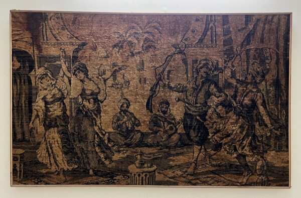
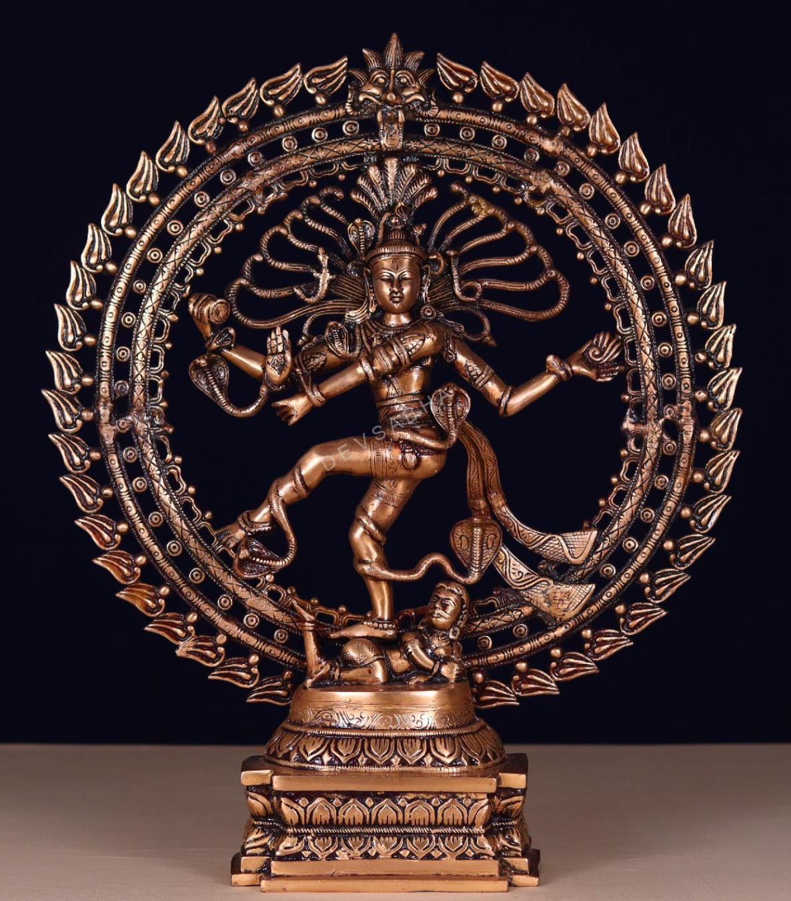
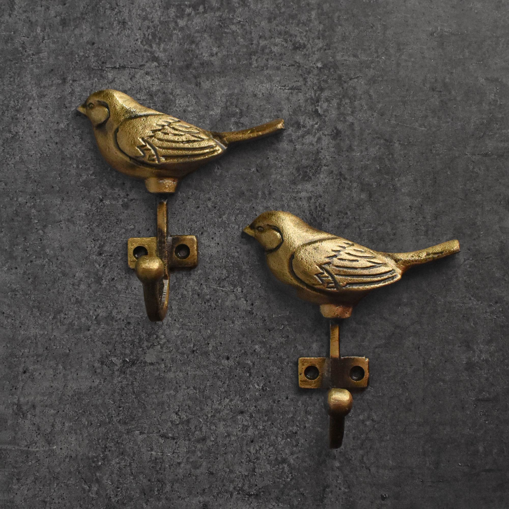
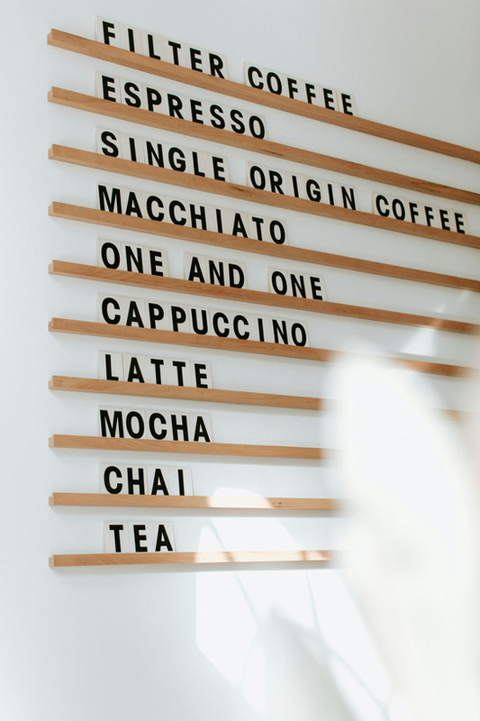

[[index|← Back to Home Overview]] · [[lighting]]

# Art, Styling, Sacred Craft & Wall Accents

Master specification for curated art, GI-certified authentic Indian craft, museum glazing, and sacred Gurudwara decor.

---

## 1. Living & Drawing Room Art & Centerpieces

| Need | Image | Tier 1: High-Quality VFM | Tier 2: High-Quality Unconstrained | Top Failure Mode & Reddit Insight |
| :--- | :--- | :--- | :--- | :--- |
| **Living Sofa-Back Wall Carpet** |  | **Retain Owned Framed Antique Persian Pictorial Wall Carpet** (Classical courtyard scene in sepia, walnut, bronze, ₹0) + [Heavy-Duty Steel Z-Bar French Cleat Wall Hanger](https://www.amazon.in/s?k=Steel+Z-Bar+French+Cleat+Wall+Hanger) (₹1,200) | **[Recommended]** [Museum-Grade Custom Reframing with Tru-Vue Conservation Clear UV-99 Glass](https://www.google.com/search?q=Museum-Grade+Custom+Reframing+with+Tru-Vue+Conservation+Clear+UV-99+Glass) + Archival Acid-Free Cotton Rag Backing & Breathing Spacer (~₹18,000) / [Tru-Vue Optium Museum Acrylic](https://www.google.com/search?q=Tru-Vue+Optium+Museum+Acrylic) (~₹34,000) |
| **Sculptural Centerpiece** |  | [Devsabha Antique Brass Nataraj Murti (27-Inch)](https://devsabha.com/product/antique-brass-nataraj-murti-height-27-inches/) (Lost-wax brass casting, antique patina, ₹43,999) / [Exotic India Art 26" Chola-Style Solid Brass Nataraja](https://www.amazon.in/s?k=Exotic+India+Art+26%22+Chola-Style+Brass+Nataraja) (Moradabad/Thanjavur sand-cast brass, ₹38,500) | **[Recommended]** [Poompuhar (Tamil Nadu Govt Handicrafts) GI-Tagged Swamimalai Bronze Nataraja (28")](https://www.google.com/search?q=Poompuhar+%28Tamil+Nadu+Govt+Handicrafts%29+GI-Tagged+Swamimalai+Bronze+Nataraja+%2828%22%29) (Authentic *cire perdue* solid Panchaloha bronze, ~₹1.15L) / [Central Cottage Industries Emporium (CCIC) Master Artisan Chola Bronze Nataraja](https://www.google.com/search?q=Central+Cottage+Industries+Emporium+%28CCIC%29+Master+Artisan+Chola+Bronze+Nataraja) (Ministry of Textiles certified heirloom casting, ~₹1.35L) / [Swamimalai Sthapathi Co-operative Custom Solid Bronze Casting](https://dir.indiamart.com/search.mp?ss=Swamimalai+Sthapathi+Co-operative+Bronze+Casting) (~₹1.25L) |
| **Foyer Coat, Bag & Key Hooks** |  | **[Recommended]** [Spruce & Pop Skye Sparrow Solid Brass Wall Hooks (Set of 3–4)](https://spruceandpop.com/collections/bestsellers/products/sparrow-coat-and-towel-wall-hook) (Solid brass sparrow motif, heavy-duty wall anchors, ₹425 ea) / [IKEA TJUSIG Wooden Wall Hanger Strip](https://www.ikea.com/in/en/p/tjusig-hanger-white-60291708/) (Solid wood, ₹999) | [Alankaram Solid Teak & Brass Peg Rail](https://www.alankaram.in/?s=Wall+Coat+Hanger&post_type=product) (Architectural teak rail with turned brass hooks, ~₹4,500) / [Muuto The Dots Brass Coat Hooks (Set of 5)](https://www.google.com/search?q=Muuto+The+Dots+Brass) (Danish architectural icon, ~₹14,500) | Adhesive tape hooks peel off acrylic emulsion paint under heavy laptop bags; drill directly into masonry with 6mm Fischer nylon plugs. |

---

## 2. Private Suites & Spaces

| Need | Image / Zone | Tier 1: High-Quality VFM | Tier 2: High-Quality Unconstrained | Top Failure Mode & Reddit Insight |
| :--- | :--- | :--- | :--- | :--- |
| **South Wall 3D World Map** |  | **[Recommended]** [Woodsify 3D Wooden World Map Multicolor (Non-LED, Size L)](https://www.woodsify.com/products/3d-wooden-world-map-multicolour?variant=42093391315150) (150×90 cm, birch plywood, ₹9,540) / [WoodScape 3D Multilayer Birch Map](https://www.amazon.in/s?k=WoodScape+3D+Multilayer+Birch+Map) (140×85 cm, natural wood stains, ₹8,990) | [Enjoy The Wood 3D Birch Map with Push Pins](https://enjoythewood.com/products/3d-wooden-world-map-multicolor) (~$249 / ₹21,000, non-toxic stains, flag pins) / [MiMi Innovations 3D Solid Hardwood Topographic World Map](https://www.amazon.in/s?k=MiMi+Innovations+3D+Hardwood+Topographic+World+Map) (Hand-stained oak/walnut relief, ~₹26,000) / [CityWood Handcrafted Multi-Layer Architectural Map](https://www.amazon.in/s?k=CityWood+Multi-Layer+Architectural+Map) (Laser-cut birch relief, ~₹32,000) |
| **Study Task & Spelling Board** |  | **[Recommended]** [Rustle Stylish Wooden Wall Menu Board (Large)](https://www.rustle.in/product-page/stylish-wooden-menu-holder?selectionIds=3) (Teak rails + birch ply tiles, 8-strip, ₹8,500) / [IKEA SVENSÅS Pegboard & Magnetic Memo Combinations](https://www.ikea.com/in/en/search/?q=SVENS%C3%85S+Pegboard+%26+Magnetic+Memo) (Powder-coated steel + cork, ₹2,990) | [George & Willy Wooden Letter Board](https://www.google.com/search?q=George+%26+Willy+Wooden+Letter+Board) (Architectural American ash rails, laser-cut timber tiles, ~$180 / ₹15,500) / [Three by Three Seattle / Chatboard Danish Magnetic Glass & Oak Board](https://www.amazon.in/s?k=Three+by+Three+Seattle) (Tempered non-ghosting magnetic glass, ~₹22,000) / [Spin Modular Perforated Steel & Solid Ash Wall Organizer](https://www.madewithspin.com/search?q=Spin+Perforated+Steel+%26+Ash+Wall+Organizer) (~₹12,500) |
| **Low-Sensory Bedtime Wall Art** | Master Bedroom | **[Recommended]** [Calcutta Art Gallery / Artzolo Framed Minimalist Linen & Botanical Serigraphs (Pair)](https://www.amazon.in/s?k=Calcutta+Art+Gallery) (Solid teak float frame, non-reflective matte acrylic, ₹12,500) / [Freedom Tree Tactile Handwoven Textile Wall Hanging](https://www.amazon.in/s?k=Freedom+Tree+Tactile+Handwoven+Textile+Wall+Hanging) (Acoustic warmth, zero glass glare, ₹9,800) | [Jaipur Rugs / Obeetee Framed Hand-Knotted Silk & Wool Wall Tapestry](https://www.amazon.in/s?k=Jaipur+Rugs) (Zero reflection, absorbs bedroom slap-echo, ~₹38,000) / [Oorjaa Handcrafted Crushed Lokta Paper & Natural Fiber Sculptural Wall Relief](https://www.amazon.in/s?k=Oorjaa+Crushed+Lokta+Paper+%26+Natural+Fiber+Sculptural+Wall+Relief) (~₹32,000) / [Kaziban / Studioekko Custom Wabi-Sabi Mineral Plaster Triptych in Solid Teak Frame](https://www.alankaram.in/?s=Kaziban&post_type=product) (~₹45,000) |
| **Sacred Gurmukhi Calligraphy & Brass Accents** | BR-03 Home Gurudwara | **[Recommended]** [Handcrafted Solid Brass Ik Onkar / Mool Mantar Wall Plaque (18")](https://www.amazon.in/s?k=Brass+Ik+Onkar) (Brushed antique brass, non-glare matte lacquer, ₹4,500) / [Sikh Virasat Framed Golden Temple Heritage Archival Print](https://www.amazon.in/s?k=Sikh+Virasat+Framed+Golden+Temple+Heritage+Archival+Print) (Acid-free mount, solid wood frame, ₹6,800) | [Amritsar Taksali Hand-Embossed Copper/Brass Repoussé Mool Mantar Panel in Solid Burma Teak Frame](https://dir.indiamart.com/search.mp?ss=Amritsar+Taksali+Hand-Embossed+Copper) (Traditional gold-leaf/brass relief, ~₹24,000) / [Bespoke Hand-Lettered Gurmukhi Shabad Calligraphy on Archival Handmade Khadi Paper + Tru-Vue UV Glass](https://www.google.com/search?q=Bespoke+Hand-Lettered+Gurmukhi+Shabad+Calligraphy+on+Archival+Handmade+Khadi+Paper+%2B+Tru-Vue+UV+Glass) (~₹28,000) / [Alankaram CNC-Carved Solid Teak & Backlit Warm 2700K Brass Jali Ik Onkar Panel](https://www.alankaram.in/?s=CNC-Carved+Teak+%26+Backlit+Warm+2700K+Brass+Jali+Ik+Onkar+Panel&post_type=product) (~₹35,000) |