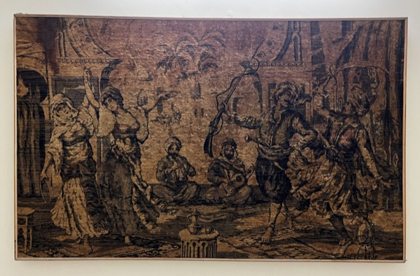
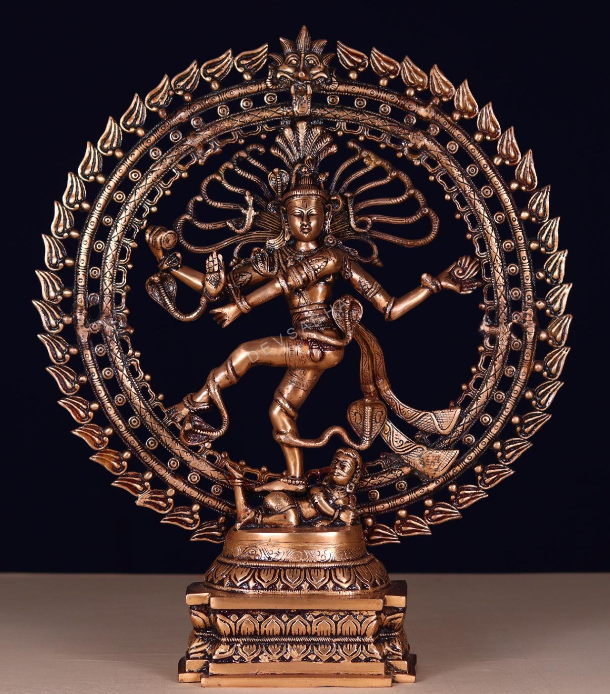
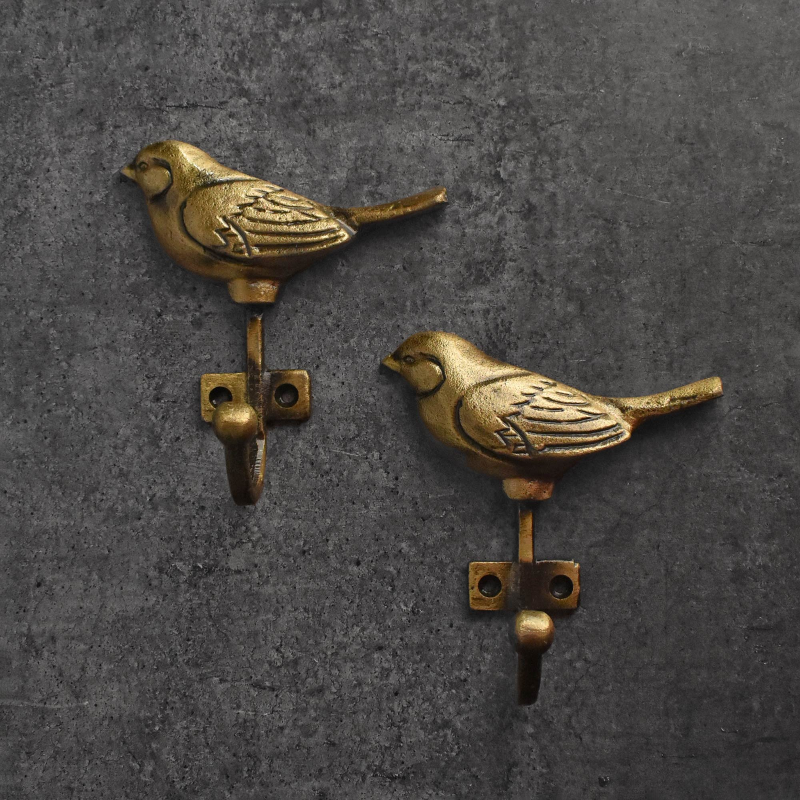
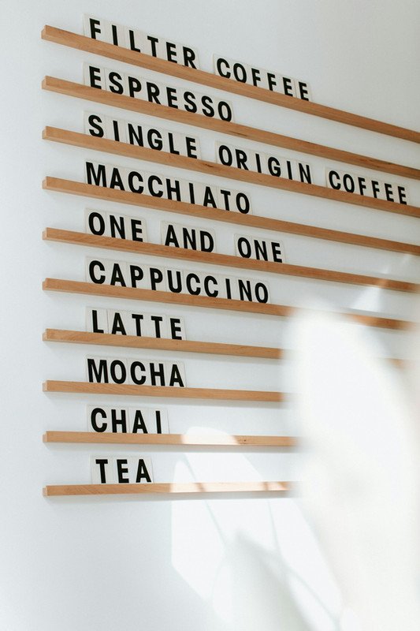

[[index|← Back to Home Overview]] · [[lighting-ambience]]

# Art & Wall Decor

Master specification for curated art, GI-certified authentic Indian craft, museum glazing, and sacred Gurudwara decor.

---

## 1. Living & Drawing Room Art & Centerpieces

| Need                                    | Image                                                                                               | Tier 1: High-Quality VFM                                                                                                                                                                                                                                                                                                                                            | Tier 2: High-Quality Unconstrained                                                                                                                                                                                                                                                                                                                                                         | Top Failure Mode & Reddit Insight                                                                                                                                                                                                                                                                          |
| :-------------------------------------- | :-------------------------------------------------------------------------------------------------- | :------------------------------------------------------------------------------------------------------------------------------------------------------------------------------------------------------------------------------------------------------------------------------------------------------------------------------------------------------------------ | :----------------------------------------------------------------------------------------------------------------------------------------------------------------------------------------------------------------------------------------------------------------------------------------------------------------------------------------------------------------------------------------- | :--------------------------------------------------------------------------------------------------------------------------------------------------------------------------------------------------------------------------------------------------------------------------------------------------------- |
| **Living Sofa-Back Wall Carpet**        |  | **Retain Owned Framed Antique Persian Pictorial Wall Carpet** (Classical courtyard scene in sepia, walnut, bronze, ₹0) + [Heavy-Duty Steel Z-Bar French Cleat Wall Hanger](https://www.google.com/search?q=Heavy-Duty+Steel+Z-Bar+French+Cleat+Wall+Hanger) (₹1,200)                                                                                                | **[Recommended]** [Museum-Grade Custom Reframing with Tru-Vue Conservation Clear UV-99 Glass](https://www.google.com/search?q=Museum-Grade+Custom+Reframing+with+Tru-Vue+Conservation+Clear+UV-99+Glass) + Archival Acid-Free Cotton Rag Backing & Breathing Spacer (~₹18,000) / [Tru-Vue Optium Museum Acrylic](https://www.google.com/search?q=Tru-Vue+Optium+Museum+Acrylic) (~₹34,000) | Standard float glass pressing directly against wool fibers traps monsoon condensation and breeds mildew; insert a 5mm archival breathing spacer and hang via interlocking aluminum French cleats.                                                                                                          |
| **Sculptural Centerpiece (Drawing Room 3D Bronze)** |  | **Tier 1 (VFM, ~₹38.5k–₹44k):** [Devsabha 27" Antique Brass Nataraj](https://devsabha.com/product/antique-brass-nataraj-murti-height-27-inches/) (₹43,999, lost-wax brass, antique patina, 16kg) / [Exotic India 26" Chola Brass](https://www.google.com/search?q=Exotic+India+Art+26%22+Chola-Style+Brass+Nataraja) (₹38,500) | **Tier 2 [Recommended] (Unconstrained Heirloom, ~₹1.15L–₹1.35L):** [Poompuhar Solid Bronze Natarajar (Swamimalai GI)](https://poompuhar.com/products/bronze-natarajar-65) (~₹1.15L–₹1.25L, authentic solid Panchaloha *cire perdue* bronze, 20–25kg) / [CCIC Master Artisan Chola Bronze (28")](https://www.cottageindustries.gov.in/) (~₹1.35L) | 27"–28" height (22"–24" halo) achieves visual balance next to the 65" TV (33" tall) and South Persian wall carpet. Display on TV console or dedicated 10" floating wall shelf. Reject hollow Moradabad sand-casts. Never use Brasso; wipe twice yearly with virgin coconut/sesame oil. |
| **Drawing Wall Plaque (Nataraja Relief)** |  | **Tier 1 (VFM, ~₹9.9k–₹12.5k):** [GiTAGGED 16" Tri-Metal Thanjavur Art Plate (Nataraja)](https://www.gitagged.com/product/thanjavur-art-plate-nataraja/) (₹9,925, authentic GI-tagged silver/copper embossed on brass with integrated wall loop) / [Exotic India 10" Copper & Wood Nataraja Wall Hanging](https://www.exoticindiaart.com/product/sculptures/10-copper-wood-nataraja-wall-hanging-wsa595/) (₹12,500) | **Tier 2 [Recommended] (Unconstrained Heirloom, ~₹35k–₹45k):** Swamimalai Sthapathi Co-operative / Poompuhar Custom Commissioned Bronze Nataraja High-Relief Wall Plaque with flush rear cleat (~₹45,000) | Off-the-shelf 24" flat-back bronze statues do not exist in traditional Indian casting. Authentic wall decor is executed via Thanjavur tri-metal embossed plates or custom flat reliefs. Mount flush at 58" eye level beside 65" TV using dual 8mm Fischer nylon wall plugs into masonry. Never hang from picture wire. |
| **Foyer Coat, Bag & Key Hooks**         |                   | **[Recommended]** [Spruce & Pop Skye Sparrow Solid Brass Wall Hooks (Set of 3–4)](https://spruceandpop.com/collections/bestsellers/products/sparrow-coat-and-towel-wall-hook) (Solid brass sparrow motif, heavy-duty wall anchors, ₹425 ea) / [IKEA TJUSIG Wooden Wall Hanger Strip](https://www.ikea.com/in/en/p/tjusig-hanger-white-60291708/) (Solid wood, ₹999) | [Alankaram Solid Teak & Brass Peg Rail](https://www.google.com/search?q=Alankaram+Solid+Teak+%26+Brass+Peg+Rail) (Architectural teak rail with turned brass hooks, ~₹4,500) / [Muuto The Dots Brass Coat Hooks (Set of 5)](https://www.google.com/search?q=Muuto+The+Dots+Brass) (Danish architectural icon, ~₹14,500)                                                                     | Adhesive tape hooks peel off acrylic emulsion paint under heavy laptop bags; drill directly into masonry with 6mm Fischer nylon plugs.                                                                                                                                                                     |
| **Foyer Luminaire & Shadow Art**        | —                                                                                                   | **[Recommended]** [Handcrafted Moroccan Pierced Brass Lantern (14"–18")](https://www.google.com/search?q=Handcrafted+Moroccan+Pierced+Brass+Pendant+Lantern) (Solid unlacquered saw-pierced brass, clear 2700K E27 filament bulb, ₹12,500–₹18,500)                                                                                                                                   | [Tazi Designs Authentic Fes Master Artisan Brass Lantern](https://www.google.com/search?q=Tazi+Designs+Moroccan+Brass+Lantern) (Hand-cut in Morocco, museum-grade openwork lace, ~$380 / ₹32,000)                                                                                                                                                                                          | Suspended in foyer entrance corner above credenza at 1,950–2,050mm AFF clear of the 1,200mm West Main Door (`MD`) swing; wired to `Aqara Dimmer H2` / `Aqara T1`. Thin stamped tin fakes rust; mandate solid saw-pierced brass. See [[lighting-ambience]]. |

---

## 2. Private Suites & Spaces

| Need | Image / Zone | Tier 1: High-Quality VFM | Tier 2: High-Quality Unconstrained | Top Failure Mode & Reddit Insight |
| :--- | :--- | :--- | :--- | :--- |
| **South Wall 3D World Map** |  | **[Recommended]** [Woodsify 3D Wooden World Map Multicolor (Non-LED, Size L)](https://www.woodsify.com/products/3d-wooden-world-map-multicolour?variant=42093391315150) (150×90 cm, birch plywood, ₹9,540) / [WoodScape 3D Multilayer Birch Map](https://www.google.com/search?q=WoodScape+3D+Multilayer+Birch+Map) (140×85 cm, natural wood stains, ₹8,990) | [Enjoy The Wood 3D Birch Map with Push Pins](https://enjoythewood.com/products/3d-wooden-world-map-multicolor) (~$249 / ₹21,000, non-toxic stains, flag pins) / [MiMi Innovations 3D Solid Hardwood Topographic World Map](https://www.google.com/search?q=MiMi+Innovations+3D+Hardwood+Topographic+World+Map) (Hand-stained oak/walnut relief, ~₹26,000) / [CityWood Handcrafted Multi-Layer Architectural Map](https://www.google.com/search?q=CityWood+Multi-Layer+Architectural+Map) (Laser-cut birch relief, ~₹32,000) | Double-sided 3M foam tape rips acrylic emulsion and gypsum paper off the wall during removal; glue map pieces onto a 6mm BWP ply backer board hung via French cleats. |
| **Study Task & Spelling Board** |  | **[Recommended]** [Rustle Stylish Wooden Wall Menu Board (Large)](https://www.rustle.in/product-page/stylish-wooden-menu-holder?selectionIds=3) (Teak rails + birch ply tiles, 8-strip, ₹8,500) / [IKEA SVENSÅS Pegboard & Magnetic Memo Combinations](https://www.google.com/search?q=IKEA+SVENS%C3%85S+Pegboard+%26+Magnetic+Memo+Combinations) (Powder-coated steel + cork, ₹2,990) | [George & Willy Wooden Letter Board](https://www.google.com/search?q=George+%26+Willy+Wooden+Letter+Board) (Architectural American ash rails, laser-cut timber tiles, ~$180 / ₹15,500) / [Three by Three Seattle / Chatboard Danish Magnetic Glass & Oak Board](https://www.google.com/search?q=Three+by+Three+Seattle) (Tempered non-ghosting magnetic glass, ~₹22,000) / [Spin Modular Perforated Steel & Solid Ash Wall Organizer](https://www.google.com/search?q=Spin+Perforated+Steel+%26+Ash+Wall+Organizer) (~₹12,500) | Cheap felt letter boards sag and shed fibers within 6 months; solid teak channel rails allow smooth letter sliding and zero dust trapping. |
| **Low-Sensory Bedtime Wall Art** | Master Bedroom | **[Recommended]** [Calcutta Art Gallery / Artzolo Framed Minimalist Linen & Botanical Serigraphs (Pair)](https://www.google.com/search?q=Calcutta+Art+Gallery) (Solid teak float frame, non-reflective matte acrylic, ₹12,500) / [Freedom Tree Tactile Handwoven Textile Wall Hanging](https://www.google.com/search?q=Freedom+Tree+Tactile+Handwoven+Textile+Wall+Hanging) (Acoustic warmth, zero glass glare, ₹9,800) | [Jaipur Rugs / Obeetee Framed Hand-Knotted Silk & Wool Wall Tapestry](https://www.google.com/search?q=Jaipur+Rugs+%2F+Obeetee+Framed+Hand-Knotted+Silk+%26+Wool+Wall+Tapestry) (Zero reflection, absorbs bedroom slap-echo, ~₹38,000) / [Oorjaa Handcrafted Crushed Lokta Paper & Natural Fiber Sculptural Wall Relief](https://www.google.com/search?q=Oorjaa+Crushed+Lokta+Paper+%26+Natural+Fiber+Sculptural+Wall+Relief) (~₹32,000) / [Kaziban / Studioekko Custom Wabi-Sabi Mineral Plaster Triptych in Solid Teak Frame](https://www.google.com/search?q=Kaziban+%2F+Studioekko+Custom+Wabi-Sabi+Mineral+Plaster+Triptych+in+Solid+Teak+Frame) (~₹45,000) | Heavy glass frames mounted over headboards risk shattering onto sleepers if hooks fail; hang only lightweight textile or matte-acrylic frames above beds using dual keyhole cleats. |
| **Sacred Gurmukhi Calligraphy & Brass Accents** | BR-03 Home Gurudwara | **[Recommended]** [Handcrafted Solid Brass Ik Onkar / Mool Mantar Wall Plaque (18")](https://www.google.com/search?q=Handcrafted+Solid+Brass+Ik+Onkar+%2F+Mool+Mantar+Wall+Plaque) (Brushed antique brass, non-glare matte lacquer, ₹4,500) / [Sikh Virasat Framed Golden Temple Heritage Archival Print](https://www.google.com/search?q=Sikh+Virasat+Framed+Golden+Temple+Heritage+Archival+Print) (Acid-free mount, solid wood frame, ₹6,800) | [Amritsar Taksali Hand-Embossed Copper/Brass Repoussé Mool Mantar Panel in Solid Burma Teak Frame](https://www.google.com/search?q=Amritsar+Taksali+Hand-Embossed+Copper) (Traditional gold-leaf/brass relief, ~₹24,000) / [Bespoke Hand-Lettered Gurmukhi Shabad Calligraphy on Archival Handmade Khadi Paper + Tru-Vue UV Glass](https://www.google.com/search?q=Bespoke+Hand-Lettered+Gurmukhi+Shabad+Calligraphy+on+Archival+Handmade+Khadi+Paper+%2B+Tru-Vue+UV+Glass) (~₹28,000) / [Alankaram CNC-Carved Solid Teak & Backlit Warm 2700K Brass Jali Ik Onkar Panel](https://www.google.com/search?q=Alankaram+CNC-Carved+Solid+Teak+%26+Backlit+Warm+2700K+Brass+Jali+Ik+Onkar+Panel) (~₹35,000) | Unlacquered brass plaques oxidize with dark fingerprints from handling; specify factory clear matte polyurethane lacquer and indirect 2700K wall-washing to prevent mirror glare. |