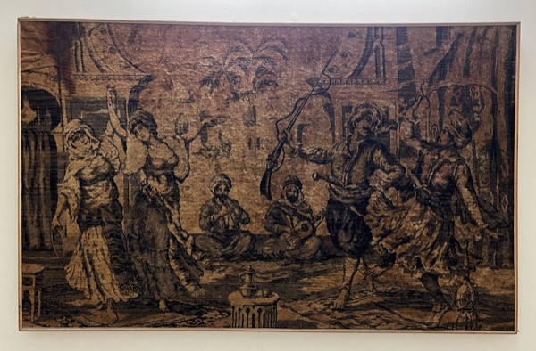
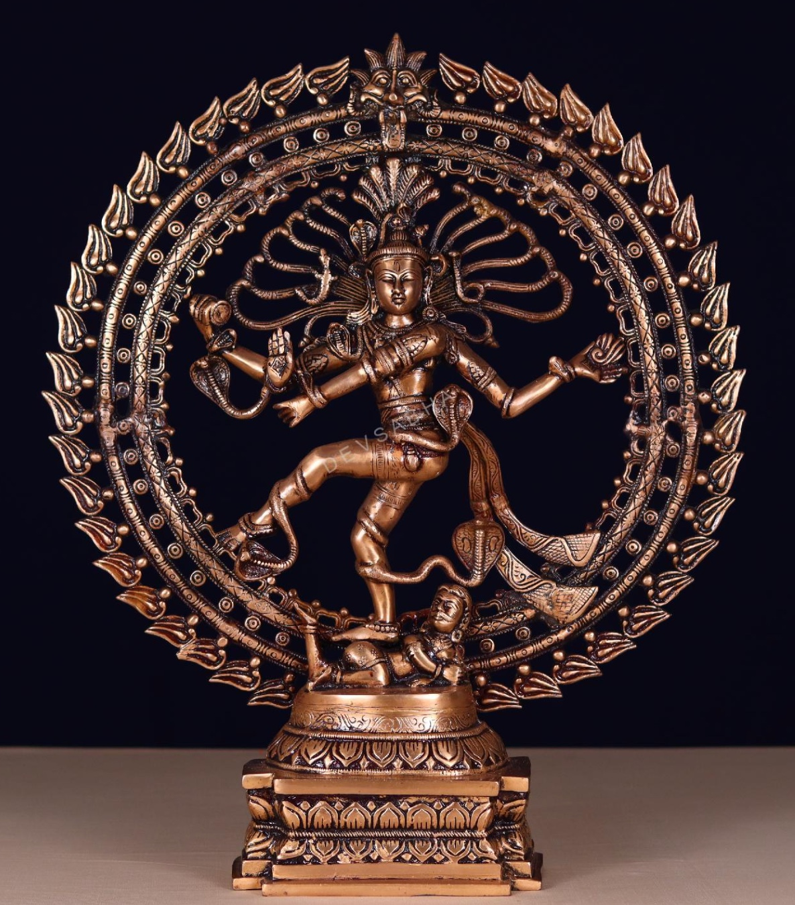
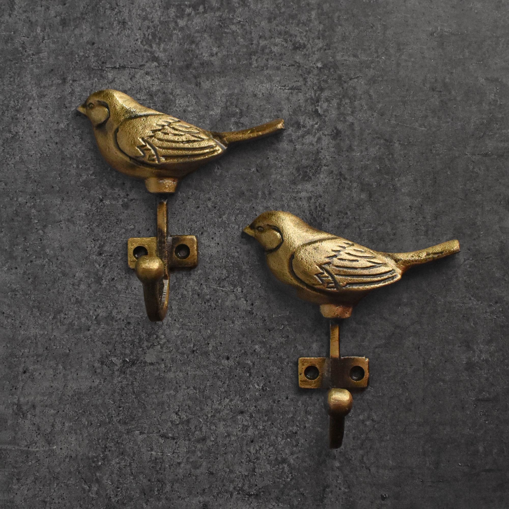
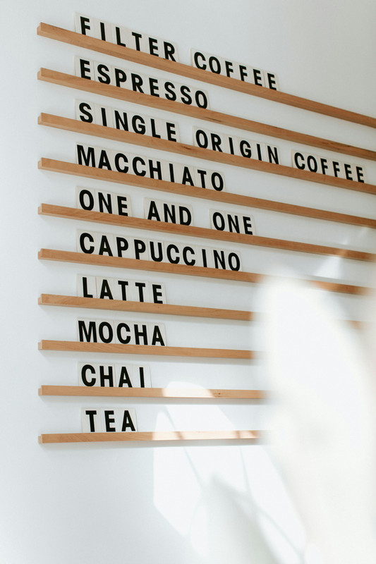

[[index|← Back to Home Overview]] · [[lighting-ambience]]

# Art & Wall Decor

Master specification for curated art, GI-certified authentic Indian craft, museum glazing, and sacred Gurudwara decor.

---

## 1. Living & Drawing Room Art & Centerpieces

| Need | Tier 1: High-Quality VFM | Tier 2: High-Quality Unconstrained | Top Failure Mode & Reddit Insight |
| :--- | :--- | :--- | :--- |
| **Living Sofa-Back Wall Carpet**  | **[Recommended]** **Retain Owned Framed Antique Persian Pictorial Wall Carpet** (Classical courtyard scene in sepia, walnut, bronze, ₹0) + **Local Framer 5mm Archival Breathing Spacer & Acid-Free Backing Refit** (₹2,500) + [Heavy-Duty Extruded Aluminum Z-Bar French Cleat Hanger](https://www.google.com/search?q=Heavy-Duty+Aluminum+Z-Bar+French+Cleat+Wall+Hanger) (₹1,200; ₹3,700 total, 8.8 durability, 9.0 VFM, 8.8 overall) | **Tier 2: None justified ($\text{VFM} < 3.0$)** — Lock Tier 1 | Standard float glass pressing directly against wool fibers traps monsoon condensation and breeds mildew; insert a 5mm archival breathing spacer and hang via interlocking aluminum Z-bar French cleats anchored into masonry/AAC block with Fischer DuoPower 8×50mm plugs. `Tru-Vue` UV-99 reframing (~₹18,000–₹34,000 at $4.9\times$) fails $\text{VFM}_2 \ge 3.0$ (`1.0 VFM`). |
| **Sculptural Centerpiece (Option A: Drawing 3D Console Bronze)**  | **[Recommended]** [Devsabha 27" Antique Brass Nataraj](https://devsabha.com/product/antique-brass-nataraj-murti-height-27-inches/) (₹43,999, solid lost-wax brass, antique patina, 17.5kg, 9.2 durability, 9.0 VFM, 9.0 overall) / [Exotic India 26" Chola Brass](https://www.exoticindiaart.com/) (₹38,500) | [Poompuhar Solid Bronze Natarajar (Swamimalai GI)](https://poompuhar.com/products/bronze-natarajar-65) (Authentic solid Panchaloha *cire perdue* bronze, 20–25kg, 9.8 durability, 4.4 VFM at $2.84\times$ price, 8.5 overall, ~₹1.15L–₹1.25L) / [CCIC Master Artisan Chola Bronze (28")](https://www.cottageindustries.gov.in/) (~₹1.35L) | 27"–28" height (22"–24" halo) balances the 65" TV (33" tall) and South Persian wall carpet. Place strictly on the M10-anchored Homz TV console deck or a floor-standing plinth secured with QuakeHold museum gel (never on a cantilever floating shelf). Reject hollow Moradabad sand-casts. Never use Brasso; wipe twice yearly with virgin coconut/sesame oil. |
| **Drawing Wall Plaque (Option B: Wall-Relief Alternative to 3D Statue)**  | **[Recommended]** [GiTAGGED 16" Tri-Metal Thanjavur Art Plate (Nataraja)](https://www.gitagged.com/product/thanjavur-art-plate-nataraja/) (₹9,925, authentic GI-tagged silver/copper embossed on brass with integrated wall loop, 9.0 durability, 9.0 VFM, 8.8 overall) / [Exotic India 10" Copper & Wood Nataraja Wall Hanging](https://www.exoticindiaart.com/product/sculptures/10-copper-wood-nataraja-wall-hanging-wsa595/) (₹12,500) | **Tier 2: None justified ($\text{VFM} < 3.0$)** — Lock Tier 1 | **Mutually Exclusive Option B** (select only if keeping the TV console deck 100% clear instead of Option A 3D bronze). Custom Swamimalai bronze relief (~₹45,000 at 4.53×) fails $\text{VFM}_2 \ge 3.0$ (`1.0 VFM`). Mount flush at 58" eye level beside 65" TV using dual 8×50mm Fischer DuoPower nylon wall plugs into masonry. |
| **Foyer Coat, Bag & Key Hooks**  | **[Recommended & Aesthetic Exception]** [Spruce & Pop Skye Sparrow Wall Hooks (Set of 4)](https://spruceandpop.com/collections/bestsellers/products/sparrow-coat-and-towel-wall-hook) (Cast iron sparrow motif, 8.0 durability, 9.0 VFM, 8.4 overall, ₹425 ea / ₹1,700 set) | [Alankaram Solid Teak & Brass Peg Rail](https://www.alankaram.in/) (Architectural teak rail with turned brass hooks, 9.2 durability, 4.9 VFM at $2.65\times$ under $k=2.5$, 8.1 overall, ~₹4,500) | Retained per user directive as an **[Aesthetic Exception]**. Reject `Muuto The Dots` (~₹14,500, `8.5×`, fails $\text{VFM}_2 \ge 3.0$). Cap load at <5 kg (keys, hats, light coats); fasten into masonry with Fischer DuoPower plugs. |
| **Foyer Luminaire & Shadow Art** | **[Recommended]** [Fos / Moradabad Hand-Pierced Solid Brass Pendant (14"–18")](https://www.foslighting.in/) (Solid hand-pierced brass, 8.8 durability, 9.0 VFM, 8.8 overall, ₹12,500–₹18,500) | [The Purple Turtles Bespoke Pierced Brass Lantern](https://thepurpleturtles.com) (Artisanal pierced brass, 9.2 durability, 6.7 VFM at 1.84×, 8.7 overall, ~₹28,500) / [Tazi Designs Authentic Fes Master Artisan Brass Lantern](https://www.google.com/search?q=Tazi+Designs+Moroccan+Brass+Lantern) (9.2 durability, 6.2 VFM at 2.06×, 8.6 overall, ~$380 / ₹32,000) | Reject thin coated-steel filigree (`Pepperfry Logam`, `₹2,500–₹5,700`, `7.6` durability) — looks tinny up close at eye level in the main entrance. Hang above credenza at 1,950–2,050mm AFF clear of the 1,200mm West Main Door (`MD`) swing; wire to ceiling-canopy `Shelly Dimmer Gen3 / Wozart` or `Aqara T1`. See [[lighting-ambience]]. |

---

## 2. Private Suites & Spaces

| Need | Tier 1: High-Quality VFM | Tier 2: High-Quality Unconstrained | Top Failure Mode & Reddit Insight |
| :--- | :--- | :--- | :--- |
| **West Wall 3D World Map (Kabir BR-02)**  | **[Recommended]** [Woodsify 3D Wooden World Map Multicolor (Non-LED, Size L)](https://www.woodsify.com/products/3d-wooden-world-map-multicolour?variant=42093391315150) (150×90 cm, birch plywood, 8.2 durability, 9.0 VFM, 8.6 overall, ₹5,689 promo / ₹9,540 reg) / [WoodScape 3D Multilayer Birch Map](https://www.google.com/search?q=WoodScape+3D+Multilayer+Birch+Map) (140×85 cm, natural wood stains, 8.2 durability, ₹8,990) | [Enjoy The Wood 3D Birch Map with Push Pins](https://enjoythewood.com/products/3d-wooden-world-map-multicolor) (Non-toxic stains, flag pins, 8.6 durability, 6.0 VFM at $2.20\times$ reg, 8.2 overall, ~$249 / ₹21,000) / [MiMi Innovations 3D Solid Hardwood Topographic World Map](https://www.google.com/search?q=MiMi+Innovations+3D+Hardwood+Topographic+World+Map) (Hand-stained oak/walnut relief, 8.8 durability, ~₹26,000) | **Owner Directive (No 6mm BWP Ply Backer):** Skip 6mm BWP ply backers and bowing 5mm sunboards; mount directly onto cured Royale paint (7–14 days post-paint) using included factory double-sided foam tape plus pea-sized neutral silicone dabs on heavy continents for child safety. Remove years later with a hair dryer and dental floss before repainting. |
| **Study Task & Spelling Board**  | **[Recommended]** [Rustle Stylish Wooden Wall Menu Board (Large)](https://www.rustle.in/product-page/stylish-wooden-menu-holder?selectionIds=3) (Solid teak channel rails + birch ply tiles, 8-strip, 8.6 durability, 8.8 VFM, 8.7 overall, ₹7,500–₹8,500) / [IKEA SVENSÅS Memo Board Pair](https://www.ikea.com/in/en/) (Powder-coated magnetic steel + cork, 8.0 durability, ₹1,998 pair) | [Spin Modular Perforated Steel & Solid Ash Wall Organizer](https://www.madewithspin.com/) (Powder-coated steel + solid ash pegs, 9.0 durability, 7.8 VFM at $1.47\times$, 8.6 overall, ~₹12,500) / [George & Willy Wooden Letter Board](https://www.georgeandwilly.com/) (American ash rails + laser-cut timber tiles, 9.0 durability, 6.9 VFM at $1.82\times$, 8.5 overall, ~$180 / ₹15,500) | Cheap felt letter boards sag and shed fibers within 6 months; solid teak channel rails allow smooth letter sliding and zero dust trapping. Fasten into masonry via Fischer DuoPower 6×30mm plugs. |
| **Low-Sensory Bedtime Wall Art** | **[Recommended]** [Dessine Art 315–350 GSM 100% Cotton Museum Paper Serigraphs in Solid Oak Frame (Pair)](https://dessineart.com) (ISO 9706 archival rag paper, non-reflective matte acrylic, 8.6 durability, 9.0 VFM, 8.8 overall, ₹9,500–₹14,000) / [Freedom Tree Tactile Handwoven Cotton-Wool Wall Hanging](https://freedomtree.in) (Acoustic warmth, zero glass glare, 8.6 durability, ₹9,800) | [Oorjaa Crushed Lokta Paper & Banana-Fiber Wall Relief](https://oorjaa.in) (Handcrafted natural fiber acoustic relief, 9.0 durability, 4.7 VFM at $2.72\times$, 8.2 overall, ~₹32,000) / [Kalakriti Art Gallery (Banjara Hills) Signed Limited Serigraph in CP Teak Frame](https://kalakriti.in/) (Archival cotton rag, 9.2 durability, 4.1 VFM at $2.98\times$, 8.1 overall, ~₹35,000) | Heavy glass frames mounted over headboards risk shattering onto sleepers if hooks fail; hang only lightweight textile (`Freedom Tree` / `Oorjaa`) or matte-acrylic cotton-rag frames (`Dessine` / `Kalakriti`; see bifl-indian-wall-art-decor-platforms) above beds using dual keyhole cleats. Tapestries >₹38k (`>3.4×`) fail $\text{VFM}_2 \ge 3.0$. |
| **Sacred Gurmukhi Calligraphy & Brass Accents** | **[Recommended]** [Handcrafted Solid Brass Ik Onkar / Mool Mantar Wall Plaque (18")](https://www.google.com/search?q=Handcrafted+Solid+Brass+Ik+Onkar+Mool+Mantar+Wall+Plaque) (Brushed antique brass passivated with natural beeswax, 9.0 durability, 9.0 VFM, 8.9 overall, ₹4,500) / [Sikh Virasat Framed Golden Temple Heritage Archival Print](https://www.google.com/search?q=Sikh+Virasat+Framed+Golden+Temple+Heritage+Archival+Print) (Acid-free mount, matte oiled solid wood frame, 8.6 durability, ₹6,800) | **Tier 2: None justified ($\text{VFM} < 3.0$)** — Lock Tier 1 | Bespoke Taksali repoussé and CNC backlit teak panels (~₹24,000–₹35,000 at $5.3\times–7.8\times$) fail the $\text{VFM}_2 \ge 3.0$ gate (`1.0 VFM`). Per [[rooms/home-gurudwara]], passivate raw brass and timber strictly with natural beeswax / microcrystalline wax (reject synthetic polyurethane gloss) and wash with indirect 2700K cove light. |