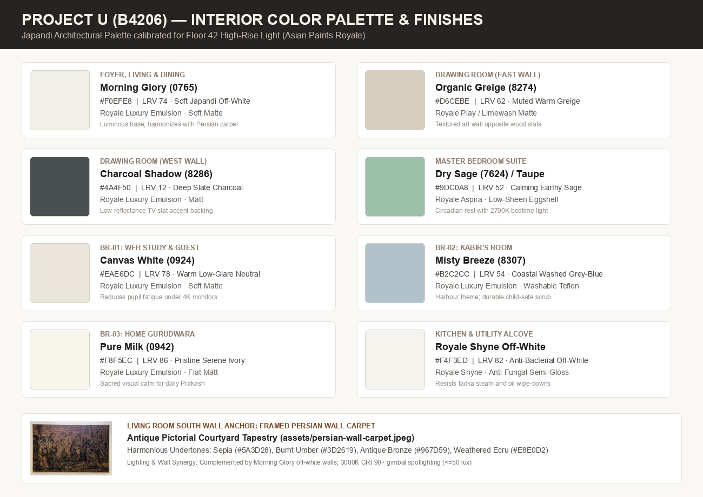
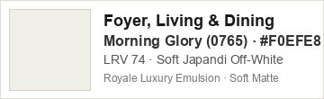
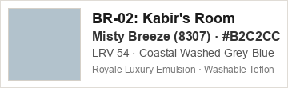
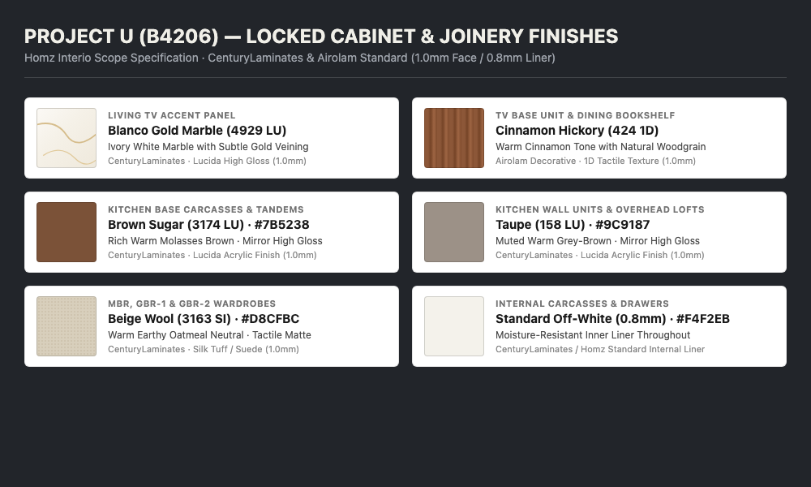
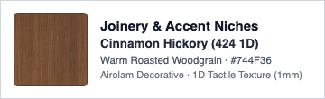
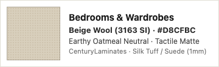
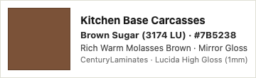
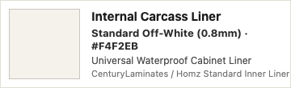
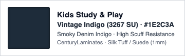

[[index|← Back to Home Overview]]

# Curtains, Paint & Finishes

Master specification for whole-home low-sheen paint palette, Homz laminate finishes, ceiling-recessed double-channel drapery, and East and South-facing solar UV protection films.

---

## 1. Interior Wall Paint & Color Palette

Cohesive Japandi architectural palette calibrated for Floor 42 high-rise natural light (combining North diffuse light and East morning glare). Pure stark whites cause clinical glare; all tones are warm low-sheen off-whites and organic neutrals (LRV 70–78).

| Component | Tier 1: High-Quality VFM | Tier 2: High-Quality Unconstrained | Top Failure Mode & Reddit Insight |
| :--- | :--- | :--- | :--- |
| **All Walls & Ceilings** | **[Recommended]** [Asian Paints Royale Luxury Emulsion (Soft Matte)](https://www.asianpaints.com/) (Teflon surface protector, anti-bacterial, washable, 8.6 durability, 9.2 VFM, 8.8 overall, ~₹490–₹520/L on 20L basis, owner direct scope) / [Dulux Velvet Touch Pearl Glo](https://www.dulux.in/) (~₹480/L) | [Asian Paints Royale Aspira / Royale Glitz Ultra Matt](https://www.asianpaints.com/) (Crack-bridging elastomeric membrane, ultra-washable dead matte, 9.2 durability, 7.7 VFM at $1.50\times$ under $k=2.5$ recoat rule, 8.7 overall, ~₹740–₹780/L) / [Benjamin Moore Aura Interior Matte](https://www.benjaminmoore.com/) (Zero VOC, 9.4 durability, ~₹2,600–₹3,000/L) | Direct application on unprimed gypsum flakes within 6 months. Grazing 2700K cove light highlights joint flashing and roller stipple; use dead matte (<5% sheen at 55°). Enforce 1 coat primer + 2 coats acrylic putty + 1 coat sealer before 2 top coats. |

### Definitive Room-by-Room Color Palette

| Room / Zone | Recommended Tone & Code (Asian Paints) | Swatch (Color) | Interior Designer Rationale & Cabinet Synergy |
| :--- | :--- | :--- | :--- |
| **Whole-Home Base Envelope** (Foyer, Living, Dining, Drawing, Master Bed, Study BR-01, Gurudwara BR-03) | **Morning Glory (0765)** (`#F0EFE8`, LRV 74) |  | Primary Japandi neutral canvas in Royale Luxury Emulsion (Soft Matte). Unifies all social and private spaces, harmonizes with `424 Cinnamon Hickory`, `3163 Beige Wool`, and Persian carpet.  **Living Room Sheen Strategy:** Split sheen across parallel walls using identical `0765` tint. TV Media Wall: burnished mineral limewash / Roman clay (cloudy suede texture, zero glare). Opposite Sofa Wall (Persian carpet): Royale Luxury Emulsion Soft Matte (scrubbable, protects against sofa rub, quiet gallery plane). |
| **Kitchen & Utility** | **Morning Glory (0765)** (`#F0EFE8`, LRV 74) · Royale Luxury Soft Matte (Teflon Stain-Guard) |  | Identical color formula in Teflon stain-repellent Soft Matte (avoids high-gloss `Royale Shyne` specular glare under 3000K kitchen ceiling coves). Links `3174 Brown Sugar` base and `#F4F2EB` off-white lofts seamlessly. |
| **BR-02 (Kabir's Room)** | **Misty Breeze (8307)** (`#B2C2CC`, LRV 54) |  | Light, desaturated coastal grey-blue. Dedicated playful accent paired with `424 Cinnamon Hickory` and blue tandem base; washable Teflon emulsion. |

---

## 2. Locked Homz Laminate Palette & Mirrors

| Zone / Joinery Unit | Main Shutter Finish & Code | Swatch (Color) | Accent / Niche Tone | Hardware & Profile Standard |
| :--- | :--- | :--- | :--- | :--- |
| **Drawing TV Unit & Media Wall (East Wall)** | Monolithic Floating Base: `424 1D Cinnamon Hickory` |  | Back Wall: `Morning Glory (0765)` mineral limewash (faux-marble `4929 LU` and black flank boxes dropped). Opposite sofa wall: Royale Soft Matte. | 18mm BWP ply French cleat + M10 anchors + slatted acoustic flaps + 200–220mm floor clearance + 50mm in-wall PVC conduit |
| **Dining Vanity & Bookshelf** | Bookshelf: `424 1D Cinnamon Hickory` · Walk-in: `3163 SI Beige Wool` |   | Common vanity with **Robot Vacuum bay**; 6mm BWP ply + 1mm laminate hidden doors (47mm total) | 4× SS304 ball-bearing hinges on hidden doors + copper-free dome mirror |
| **Kitchen Cabinets** | **Base:** `3174 LU Brown Sugar` **Wall & Lofts:** **Warm Off-White (`#F4F2EB`)** |   | Light-shade Indian granite worktop (owner-sourced) + `0.8 mm Off-White` liner | 9× Hettich/Blum soft-close tandem drawers + G-profile / edge pulls |
| **Master Suite & Wardrobes** | `3163 SI Beige Wool` (Wardrobes & Dresser) |  | Tall dresser with full-height dome mirror (bed-back in Morning Glory 0765 Soft Matte) | [Spruce & Pop Claro Solid Brass](https://spruceandpop.com/products/claro-antique-brass-knurled-cabinet-drawer-knob-and-handle) in Brushed Satin Brass (256mm doors, 128mm drawers) + Blum soft-close |
| **BR-02 Kabir's Wardrobe** | `3163 SI Beige Wool` (Entire wardrobe & lofts) |  | Leftmost Niche: Wall-to-wall `424 1D Cinnamon Hickory` (no bottom drawers) Base Band: 4 tandem drawers in **CenturyLaminates `3267 SI` Vintage Indigo**   | Mantara W-0024 beech elephant knobs (single center hole on shutters & drawers) + Blum soft-close |

---

## 3. Window Treatments & Solar Glazing Matrix

| Need | Tier 1: High-Quality VFM | Tier 2: High-Quality Unconstrained | Top Failure Mode & Reddit Insight |
| :--- | :--- | :--- | :--- |
| **Window Drapery (6 Openings)** | **[Recommended]** [D'Decor / Sarom Performance Fabrics](https://www.ddecor.com/) (Blue Wool 6+ lightfastness, 2.25× pinch pleat + detachable 3-pass blackout, 8.6 durability, 9.0 VFM, 8.8 overall, ~₹1.1L–1.5L via Bhavani Furnishings) / [GM Fabrics / RR Decor Textured Slub Weaves + Voile Sheers](https://www.gmfabrics.com/) (~₹1.05L) | [Pure European Linen + 3-Pass Acoustic Thermal Blackout](https://www.google.com/search?q=Pure+European+Linen+3-Pass+Blackout) (Belgian/Italian flax linen, lead-weighted bottom hems, S-wave / Euro pleat, 8.8 durability, 6.7 VFM at $1.92\times$ under $k=2.5$, 8.6 overall, ~₹2.2L–2.8L via Bhavani / Neo Fabrique) / [Atmosphere / Nilaya Luxury Drapery](https://www.asianpaints.com/) (~₹2.5L) | Ready-made online panels (250cm) fall 30cm short of high-rise 2.8m finished drops; cheap non-woven blackout linings disintegrate after 2 laundry cycles. Always demand detachable 3-pass woven blackout lining. |
| **Curtain Track System** | **[Recommended]** [MAC / Marvel Heavy-Duty Extruded Aluminum Ripple-Fold Track](https://www.google.com/search?q=MAC+Marvel+Heavy-Duty+Ripple-Fold+Track) (Continuous single-piece extruded rail, wheeled ball-bearing runners, 8.8 durability, 9.0 VFM, 8.9 overall, ₹240/ft via Bhavani) | [Forest KS S-Wave Track](https://www.forestgroup.com/) (Powder-coated aluminum S-wave rail, 9.3 durability, 4.4 VFM at $2.83\times$ under $k=2.5$, 8.4 overall, ₹680/ft) / [Silent Gliss 6870 / 3840 Recessed Architectural Profile](https://www.silentgliss.com/) (Swiss 2C gliders, 9.5 durability, 5.8 VFM at $3.54\times$ under $k=1.25$ recessed ceiling profile, 8.7 overall, ₹850/ft) | Disqualified IKEA VIDGA (5.8 BIFL score; plastic splice clips sag and jam on 3.6m sliders). Mandate continuous single-piece extruded aluminum rails screwed into 18mm BWP ply inside the Homz ceiling pelmet. |
| **Master Suite Automated Drapery** | [Dooya DT82 / Zemismart Zigbee 3.0 Hardwired Motorized Belt Track](https://www.zemismart.com/) (230V mains powered, heavy-duty toothed-belt drive, 8.4 durability, 9.0 VFM, 8.6 overall, ₹14,500) | **[Recommended]** [Aqara Curtain Controller C3 (`ZNCLDJ01LM`) / Hardwired Zigbee Motor (`CD-M01D`)](https://in.modo.store/) + Motorized Belt Track (230V hardwired, native Zigbee 3.0 binding to M3, <26dB, 50–80kg load, 8.9 durability, 7.3 VFM at $1.69\times$ [8.1 VFM under $k=1.25$], 8.8 overall, ₹24,500) / [Somfy Glydea Ultra 60e DCT](https://www.somfy.co.in/) (9.4 durability, ~₹32,000) | Disqualified battery friction-wheel robots (Aqara E1 `CM-M01` / SwitchBot 3; score 6.2 BIFL, micro-slip on 2.8m blackout drapes). Heavy blackout drapery requires a hardwired 230V toothed-belt drive with end gearboxes. Homz pelmet requires $\ge 220\text{ mm}$ width with 6A socket on RHS. |
| **Solar Heat & UV Glazing (East & South Glass)** | [Garware Suncontrol Ice Cool / Daylight Film](https://www.google.com/search?q=Garware+Suncontrol+High-Performance+Ice+Cool) (70% VLT, ~38–42% TSER, 8.2 durability, 8.5 overall, ₹180/sq ft) / [Llumar N1065](https://www.google.com/search?q=Llumar+N1065) (8.5 durability, ₹260/sq ft) | **[Recommended]** [3M Prestige 70 Optical Film](https://www.3mindia.in/3M/en_IN/p/d/v000080644/) (200+ non-metallic nano-layers, 97% IR heat rejection, 50–59% TSER, 99.9% UV block, zero night mirror effect, 9.2 durability, 8.7 overall under $k=1.25$ tear-out rule, ₹580/sq ft across East Sit-Out Slider + South Master Balcony `SD2`, BR-01 Study `W2`, and Kitchen `CW`) / [Saint-Gobain Solar Gard](https://www.google.com/search?q=Saint-Gobain+Solar+Gard+Panorama+Hilite+70) (9.0 durability, ₹520/sq ft) | Floor 42 South glazing absorbs 5.5 hrs of peak midday heat; applying 3M Prestige 70 across both East and South glass cuts VRF thermal load by ~1.2 TR and protects the Persian carpet, BR-01 leather chair, and Master wood floor from UV bleaching. |