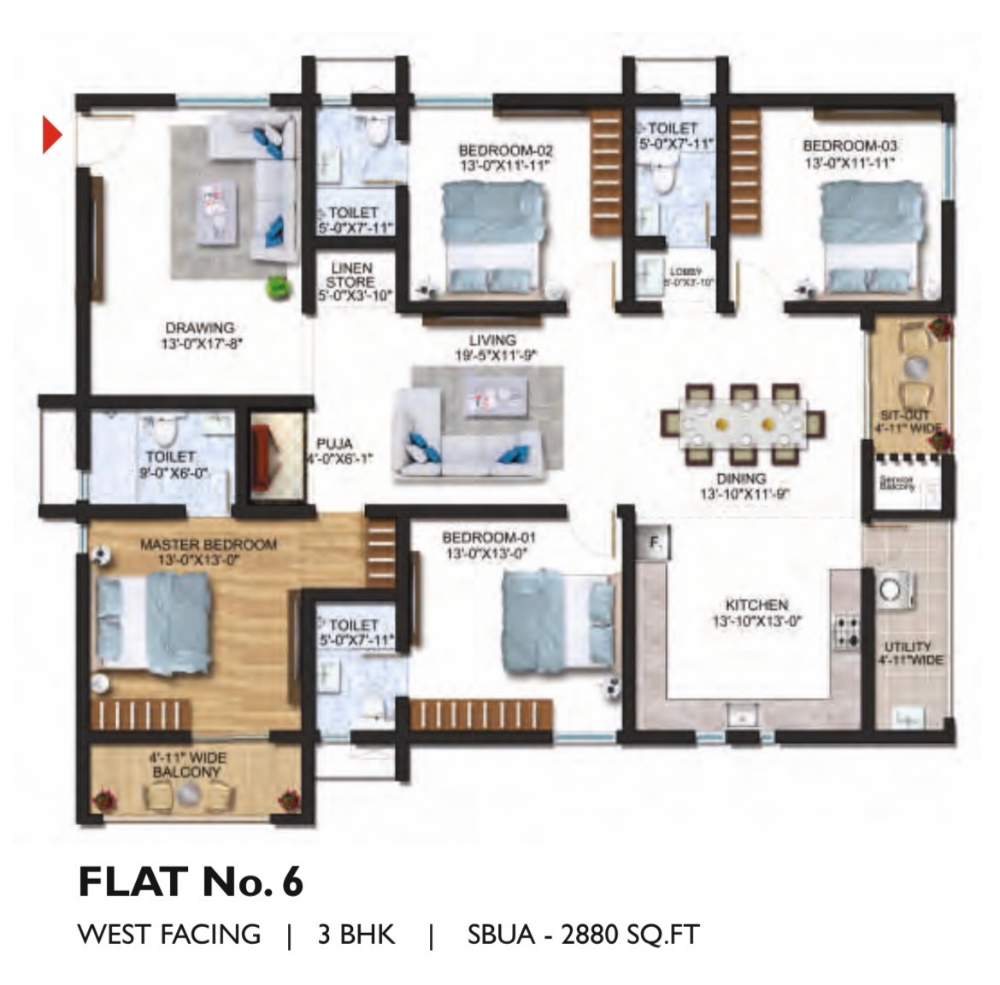
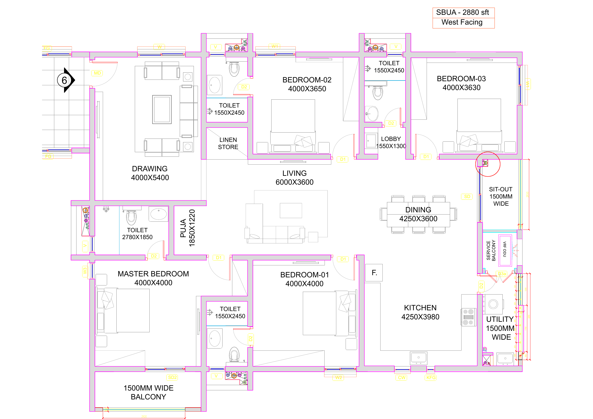

[[index|← Back to Home Overview]] · [[high-rise-engineering-gotchas]]

# Plans & Drawings

Definitive Good-For-Construction (GFC) engineering records for Unit B-6 (B4206, Floor 42, Tower B, Sumadhura The Olympus). SBUA is 2880 sft with West facing orientation. Sourced directly from builder technical submittals.

---

## 1. Master Drawing Inventory & Assets

| Discipline | Drawing Title | Source File (Vector PDF) | High-Res Preview (PNG / JPG) | Sheet Size & Scale | GFC Date | Key Focus |
| :--- | :--- | :--- | :--- | :--- | :--- | :--- |
| **Brochure Floor Plan (2880 SFT)** | Sumadhura Olympus 2880 Plan | — | [house-plan-2880.jpeg](assets/builder-drawings/house-plan-2880.jpeg) | JPEG (High-Res) | 2021 | Marketing layout with furniture circulation |
| **Architectural GFC Plan** | 100-TOWER-A&B TYPICAL PLANS | [floor-b6.pdf](assets/builder-drawings/floor-b6.pdf) | [floor-b6.png](assets/builder-drawings/floor-b6.png) | A3 (ZWCAD) | 2024-04-19 | Clear room mm dimensions, doors, windows, balconies |
| **HVAC (VRV Layout)** | MEP DRAWING TOWER-B FLOOR PLAN | [hvac-b6.pdf](assets/builder-drawings/hvac-b6.pdf) | [hvac-b6.png](assets/builder-drawings/hvac-b6.png) | A3 (AutoCAD) | 2023-08-24 | 10 HP Daikin VRV, 7 IDUs, copper sizes, condensate drains |
| **Plumbing & Sanitary** | PLUMBING TOWER-B FLOOR PLAN | [plumbing-b6.pdf](assets/builder-drawings/plumbing-b6.pdf) | [plumbing-b6.png](assets/builder-drawings/plumbing-b6.png) | A4 (2 Sheets) | 2026-04-08 | 7 plumbing shafts, DWS/MWS/FWS, soil/waste risers |
| **Electrical & Low Voltage** | ELECTRICAL TOWER-B FLOOR PLAN | [electrical-b6.pdf](assets/builder-drawings/electrical-b6.pdf) | [electrical-b6.png](assets/builder-drawings/electrical-b6.png) | A4 (3 Sheets) | 2026-04-08 | DB, CJB, 20A geysers, 16A power drops, lighting conduits |

---

## 2. Floor Plan Drawings

### 2880 SFT Furniture Floor Plan

### Good-For-Construction (GFC) Architectural Plan

---

## 3. Architectural Dimension Schedule (Clear Internal)

| Space | Dimensions (mm) | Dimensions (ft / in) | Shutter / Window Schedule | Attached Features |
| :--- | :--- | :--- | :--- | :--- |
| **Drawing Room** | 4000 × 5400 | 13'1" × 17'8" | Main Door (MD) West, FG, W | Foyer transition, 2.08 TR concealed AC |
| **Living Room** | 6000 × 3600 | 19'8" × 11'10" | Sliding Door (SD) to Sit-out | 1500 mm wide Sit-out balcony |
| **Dining Room** | 4250 × 3600 | 13'11" × 11'10" | Open to living & kitchen corridor | 2.08 TR concealed AC, vanity transition |
| **Kitchen** | 4250 × 3980 | 13'11" × 13'1" | Corner Window (CW), KFG, D2 | 1500 mm Utility, P-SHAFT-61 |
| **Puja Room** | 1850 × 1220 | 6'1" × 4'0" | D1 flush shutter | North of Master Bedroom |
| **Master Bedroom** | 4000 × 4000 | 13'1" × 13'1" | SD2 to South balcony, D1 | 1500 mm private balcony, dressing nook |
| **Master Toilet** | 2780 × 1850 | 9'1" × 6'1" | D2, Ventilator (V) | P-SHAFT-63, shower zone, 20A geyser |
| **Bedroom-01 (Study/Guest)** | 4000 × 4000 | 13'1" × 13'1" | Window W2 (South), D1 | South window desk zone, attached ensuite |
| **BR-01 Toilet** | 1550 × 2450 | 5'1" × 8'0" | D2, Ventilator (V) | P-SHAFT-62, 20A geyser |
| **Bedroom-02 (Kabir)** | 4000 × 3650 | 13'1" × 12'0" | Window W1 (East), D1 | North niche wardrobe, attached ensuite |
| **BR-02 Toilet** | 1550 × 2450 | 5'1" × 8'0" | D2, Ventilator (V) | P-SHAFT-59, 20A geyser |
| **Bedroom-03 (Gurudwara)** | 4000 × 3630 | 13'1" × 11'11" | Window W1 (East), D1 | Dedicated sacred Prakash space |
| **BR-03 Toilet** | 1550 × 2450 | 5'1" × 8'0" | D2, Ventilator (V) | P-SHAFT-58, 20A geyser |
| **Lobby & Linen Store** | 1550 × 1300 | 5'1" × 4'3" | Corridor distribution | Central DB & CJB placement |
| **Service Balcony** | 1500 mm wide | 4'11" wide | D3a from Utility | Houses 10 HP Daikin VRV ODU |

---

## 3. Daikin VRV HVAC Engineering Schedule

System driven by a single **10 HP Daikin VRV Outdoor Unit (ODU)** on the Service Balcony ledge. Connected indoor capacity: **10.76 TR** across 7 IDUs.

| Zone | IDU Model Number | Capacity | Unit Type | Copper Line (Gas/Liq) | Drain Header |
| :--- | :--- | :--- | :--- | :--- | :--- |
| **Drawing Room** | `FSFXQ63ARV16` | 2.08 TR | Slim Duct Concealed Ceiling | 15.9 mm / 9.5 mm (4.5 RMT) | 40 mm Ø PVC |
| **Living Room** | `FSFXQ40ARV16` | 1.32 TR | Slim Duct Concealed Ceiling | 12.7 mm / 6.4 mm (3.2 RMT) | 40 mm Ø PVC |
| **Dining Room** | `FSFXQ63ARV16` | 2.08 TR | Slim Duct Concealed Ceiling | 15.9 mm / 9.5 mm (5.0 RMT) | 40 mm Ø PVC |
| **Master Bedroom** | `FXAQ40ARVE6` | 1.32 TR | Wall Mounted / Concealed | 12.7 mm / 6.4 mm (3.9 RMT) | 32 mm Ø PVC |
| **Bedroom-01 (Study)** | `FSAQ40ARVE6` | 1.32 TR | Wall Mounted Unit | 12.7 mm / 6.4 mm (3.4 RMT) | 25 mm Ø PVC |
| **Bedroom-02 (Kabir)** | `FSAQ40ARVE6` | 1.32 TR | Wall Mounted Unit | 12.7 mm / 6.4 mm (2.2 RMT) | 25 mm Ø PVC |
| **Bedroom-03 (Gurudwara)**| `FSAQ40ARVE6` | 1.32 TR | Wall Mounted Unit | 12.7 mm / 6.4 mm (2.6 RMT) | 25 mm Ø PVC |

* **Main Refrigerant Headers:** 22.2 mm / 9.5 mm copper runs (7.6 RMT and 4.0 RMT) connected via Daikin Refnets (`286 33T`, `246 33T`, `183 22T`, `103 22T`, `80 22T`, `326 33T`).
* **Condensate Network:** 40 mm and 32 mm primary headers sloping minimum 1:100 toward plumbing shafts.

---

## 4. Plumbing Shafts & Water Distribution

| Shaft ID | Location | Served Fixtures & Stacks | Pipe Diameters & Types |
| :--- | :--- | :--- | :--- |
| **P-SHAFT-58** | North-East Wall (BR-03) | BR-03 Toilet WC, Basin, Geyser | 110 mm Soil, 75 mm Waste, 25 mm DWS, 20 mm FWS/HWS |
| **P-SHAFT-59** | North Wall (BR-02) | BR-02 Toilet WC, Basin, Geyser | 110 mm Soil, 75 mm Waste, 25 mm DWS, 20 mm FWS/HWS |
| **P-SHAFT-60** | East Outer Ledge | Utility stack & rainwater | 75 mm Waste, 75/50 mm BRW Rainwater |
| **P-SHAFT-61** | South-East Wall (Kitchen) | Kitchen sink, dishwasher/RO bypass | 75 mm Kitchen Waste, 50 mm Utility, 20 mm MWS |
| **P-SHAFT-62** | South Wall (BR-01) | BR-01 Toilet WC, Basin, Geyser | 110 mm Soil, 75 mm Waste, 25 mm DWS, 20 mm FWS/HWS |
| **P-SHAFT-63** | South-West Wall (Master) | Master Toilet WC, Basin, Shower | 110 mm Soil, 75 mm Waste, 32 mm DWS, 20 mm FWS/HWS |
| **P-SHAFT-74** | Service Balcony | VRV condensate & utility drain | 50 mm Waste, 32 mm Water Meter feed |

---

## 5. Electrical Distribution & Low Voltage

* **Distribution Board (DB):** Surface-recessed in entrance lobby corridor. Fed with 3-phase supply. Feeds 25 mm Ø lighting conduits and 25 mm Ø power conduits.
* **Communication Junction Box (CJB):** Recessed next to DB. Terminates Cat6 internet drops, TV coax, and building intercom lines.
* **Geyser Circuits:** Dedicated 20A isolator switches wired to 20A 3-pin sockets in Master Toilet, BR-01 Toilet, BR-02 Toilet, and BR-03 Toilet.
* **Power Outlets (15A/16A):** Kitchen counter loop (hob, chimney, oven, microwave), Utility laundry stack (washer/dryer), and refrigerator niche.
* **Lighting & Fans:** 1200 mm sweep fan hooks centered in all bedrooms and living zones; 305 mm exhaust fan cutouts in all toilets and kitchen.