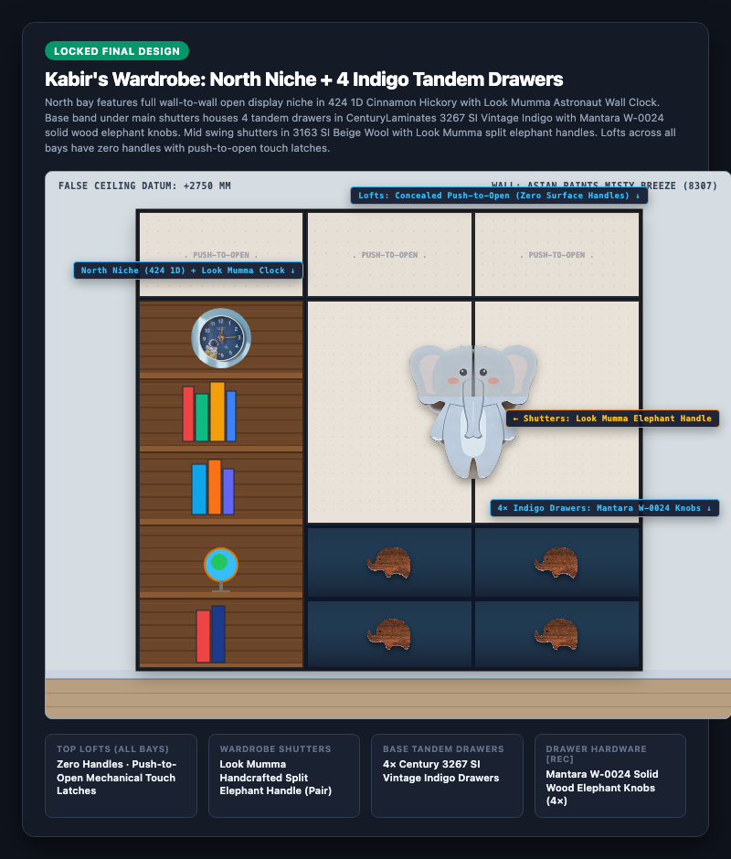

[[index|← Back to Home Overview]]

# Kabir's Room (Study & Play — 13'0" × 11'11")

Dedicated study, reading, and creative play space for Kabir (age 6, Grade 1 at Keystone). Features ergonomic growth furniture (manual crank desk, non-rolling study chair), child-safe low daybed with guest trundle, and the South wall 3D wooden world map above the daybed.

> **Child Safety Mandate:** Reject rolling swivel chairs and motorized high sit-stand desks (pinch hazard & high minimum clearance). Anchor daybed and tall units to RCC walls with Fischer plugs.
> **Owner Exceptions (`Child Daybed / Sleeper` Only):** (1) Durability may go as low as **6.0**; (2) **Bespoke local master-joiner CP Teak is excluded** (not an option for this row).
> **Finishes Reference:** Wall finish references [[curtains-paint-finishes#definitive-room-by-room-color-palette]].

---

## Kabir's Room Hardware & Furnishings

| Need | Tier 1: High-Quality VFM | Tier 2: High-Quality Unconstrained | Top Failure Mode & Reddit Insight |
| :--- | :--- | :--- | :--- |
| **KBR Wardrobe (Homz Locked)** | **[Recommended]** **Locked Design: North Niche + Indigo Tandem Drawers:** Entire wardrobe and lofts in CenturyLaminates `3163 SI Beige Wool`; leftmost (North) bay features full wall-to-wall open `424 1D Cinnamon Hickory` display niche beside study desk (bottom drawers removed) housing open book shelves; base band under wardrobe shutters houses 4 tandem drawers in CenturyLaminates `3267 SI Vintage Indigo` (scuff protection) with Mantara W-0024 solid beech elephant knobs; upper mid swing shutters fitted with Mantara W-0024 single-bolt beech knobs (or Spruce & Pop Claro 256mm CC); top lofts across all bays strictly omit surface handles and operate via concealed mechanical push-to-open touch latches. | [Greenlam AFX Neutral + Solid Woodgrain Niche + FENIX](https://www.google.com/search?q=Greenlam+AFX+Neutral+%2B+Oak+Niche+%2B+FENIX) (Century Club Prime, Blum BLUMOTION soft-close channels, ~₹1.85L) / [Merino Luvih Super-Matt + Blum LEGRABOX](https://www.google.com/search?q=Merino+Luvih+Super-Matt+%2B+Blum+LEGRABOX) (Finger-safe soft-close dampers, ~₹1.75L) | Cartoon laminates date poorly by age 9; grounding the base in scuff-resistant `3267 SI` Vintage Indigo protects against kicks while `3163 SI` Beige Wool maintains whole-house Japandi continuity and single-brand Century procurement. |
| **Child Daybed / Sleeper** | [IKEA VIHALS Day-bed Frame with Trundle (80×200 cm)](https://www.ikea.com/in/en/p/vihals-day-bed-w-trundle-bed-2-mattresses-white-agotnes-firm-s59580634/) (`>= 6.0` durability exception; particleboard + wooden slats, 6.2 durability, 9.3 VFM, 7.6 overall, ₹20,990 frame / ₹28,970 w/ 2 mattresses) / [Boingg! Kids Daybed with Trundle](https://boingg.in/) (`36×75 in` Indian sizing, pine + 18mm MDF/HDF, 6.8 durability, 7.8 VFM, 7.6 overall, ₹31,185–₹38,427) | **[Recommended]** [Magari / Alankaram Bespoke Solid Ash or Teak Daybed with Trundle](https://www.magari.in/) (Showroom kiln-dried European ash / Burma teak, mortise-and-tenon joinery, `36×75 in` Indian sizing, rounded child-safe bullnose edges, 9.5 durability, 4.9 VFM at $4.53\times$ under $k=1.25$, 8.5 overall, ~₹95,000) | Bespoke local CP Teak excluded per owner exception. Under the `>= 6.0` exception, `IKEA VIHALS` (`₹20,990`, `57.7` composite) leads Tier 1 over `Boingg!` (`53.0`), though `r/IKEA` notes plastic-peg slats dislodge/snap under jumping or kneeling. Tier 2 `Magari / Alankaram` (`8.5` overall) still beats `IKEA VIHALS` (`7.6`) on solid mortise-and-tenon longevity and `36×75"` Indian mattress fit. Disqualify Jodhpur Sheesham dropshippers (`WoodenStreet Kendra`). Cap lower trundle mattress at **5" (125mm)**. |
| **Kids Reading Pouffe / Sleeper** | **[Recommended]** [IKEA KOMPISHÄNG Mattress/Pouffe (80×200 cm)](https://www.ikea.com/in/en/p/kompishaeng-mattress-pouffe-beige-red-60628767/) (13 cm pocket springs resist sagging, tri-fold pouffe 80×68 cm, 8.2 durability, 8.6 overall, ₹12,990) | **Tier 2: None justified ($\text{VFM} < 3.0$)** — Lock Tier 1 | Disqualify thin PU foam mats (`IKEA SLÄKT`, ₹5,500, `6.8` durability). `Karup Hippo` (~₹48k, `3.70×`, EU import) & `BoConcept Xtra` (₹85,950, `6.62×`) fail $\text{VFM}_2 \ge 3.0$ and India-sourcing gates. `r/IKEA`: KOMPISHÄNG outer cover is hard to wash; use a fitted cotton sheet. |
| **Ergonomic Study Desk** | [IKEA BERGLÄRKA Kids Crank Desk (120×70 cm)](https://www.ikea.com/in/en/p/berglaerka-desk-white-tiltable-s09488671/) (Manual crank 52–75 cm, 10°/20°/30° tiltable top, EN 17191:2021 tested, 7.6 durability, 9.0 VFM, 8.3 overall, ₹14,990; Trade-Off Call: `68.4` composite efficiency) | **[Recommended]** [Magari / Alankaram Custom Solid Ash/Teak Step-Height Desk + Easel](https://www.magari.in/) (120×70 cm kiln-dried European ash / Burma teak, bolted step-height legs 53/59/65/74 cm + removable solid-wood reading/drawing easel, 9.3 durability, 6.5 VFM at $3.00\times$ under $k=1.25$, 8.5 overall, ~₹45,000) | Disqualified Alex Daisy Pluto (`6.5` durability `< 7.0` hard gate) and adult-only ErgoYou M8 / Jin Nova (`70–74 cm` min height, flat top). European BIFL kids' desks (Moll, Paidia) do not ship officially to India. `r/IKEA` notes slight telescopic leg wobble on BERGLÄRKA at tall heights and "Last chance to buy" stock risk; Magari/Alankaram solid-wood top bolts onto an ErgoYou E15 electric frame at age 10+. |
| **Growth Desk Chair** | [Custom Solid CP Teak Slotted Growth Chair](https://www.google.com/) (Local master joiner CAD build, zero wheels, zero swivel, slotted grooves 34–52 cm seat + adjustable footrest plate, 8.6 durability, 8.8 VFM, 8.7 overall, ₹11,500) | **[Recommended]** [Magari / Alankaram Custom Solid Ash/Teak Slotted Growth Chair](https://www.magari.in/) (Zero wheels, zero swivel, mortise-and-tenon showroom finish, slotted seat 34–52 cm + adjustable footrest, 9.2 durability, 7.4 VFM at $2.09\times$ under $k=1.25$, 8.7 overall, ~₹24,000) | Disqualified IKEA SIBBEN / VIMUND (swivels 360°, violating room zero-wheel/zero-swivel mandate; 10 mm IKEA glide stems rare in India) and Stokke Tripp Trapp (unrealistic India sourcing; lowest groove 42.5 cm). Slotted solid timber sets seat to 34–38 cm for 53–55 cm desk now with 90° flat foot support. |
| **South Wall 3D World Map (Above Daybed)** | **[Recommended]** [Woodsify 3D Wooden World Map Multicolor (Non-LED, Size L)](https://www.woodsify.com/products/3d-wooden-world-map-multicolour?variant=42093391315150) (150×90 cm, birch plywood, 8.2 durability, 9.0 VFM, 8.6 overall, ₹5,689 promo / ₹9,540 reg) / [WoodScape 3D Multilayer Birch Map](https://www.google.com/search?q=WoodScape+3D+Multilayer+Birch+Map) (140×85 cm, natural wood stains, 8.2 durability, ₹8,990) | [Enjoy The Wood 3D Birch Map with Push Pins](https://enjoythewood.com/products/3d-wooden-world-map-multicolor) (Non-toxic stains, flag pins, 8.6 durability, 6.0 VFM at $2.20\times$, 8.2 overall, ~$249 / ₹21,000) / [MiMi Innovations 3D Solid Hardwood Topographic World Map](https://www.google.com/search?q=MiMi+Innovations+3D+Hardwood+Topographic+World+Map) (8.8 durability, ~₹26,000) | **Owner Directive (South Wall, No 6mm BWP Ply Backer):** Mount directly onto cured South wall Royale paint above the daybed (clear of East Henka sconce) using included factory double-sided foam tape plus pea-sized neutral silicone dabs on heavy continents. Remove years later with a hair dryer and dental floss. Detail in [[art-wall-decor]]. |
| **Wardrobe Shutter Hardware** | **[Recommended]** [Mantara W-0024 Elephant Knob](https://www.mantara.in/products/mantara-w-0024-elephant) (Solid natural beech wood, 50mm Ø, single M4 center through-bolt, 8.6 durability, 9.0 VFM, 8.7 overall, ₹649–₹863 ea, owner supply) / **[Aesthetic Exception]** [Look Mumma Elephant Wooden Handles (96mm CC)](https://www.google.com/search?q=Look+Mumma+Elephant+Wooden+Handles) (Acacia pull, ₹399 ea; *96mm CC locks out 256mm adult pulls*) | [Spruce & Pop Claro Solid Brass Pulls (256mm CC)](https://spruceandpop.com/products/claro-antique-brass-knurled-cabinet-drawer-knob-and-handle) (Brushed Satin Brass, 9.4 durability, 3.9 VFM at $3.03\times$, 8.2 overall, ₹2,275 ea) | Single M4 center hole on `Mantara W-0024` transitions to adult pulls around age 10 without patching veneer; if using `Look Mumma` 96mm CC pulls, fit rubber washers on M4 bolts and hand-tighten only. |
| **Wardrobe Tandem Drawer Knobs (Beech Elephant)** | **[Recommended]** [Mantara W-0024 Elephant Knob](https://www.mantara.in/products/mantara-w-0024-elephant) (Solid natural beech wood, 50mm single-point knob with brass threaded insert, 8.6 durability, 9.0 VFM, 8.8 overall, ₹649 ea, 4 units, owner supply) | [Spruce & Pop Claro Solid Brass Drawer Pull (128mm CC)](https://spruceandpop.com/products/claro-antique-brass-knurled-cabinet-drawer-knob-and-handle) (Solid knurled brass, 9.4 durability, 6.6 VFM at $1.96\times$, 8.7 overall, ₹1,275 ea) / [Mantara Safari Solid Wood & Brass Knobs](https://www.mantara.in) (~₹750 ea) | Drawers endure higher pull frequencies than tall shutters; solid beech wood with factory brass inserts prevents thread stripping under rapid yank loads. |
| **Study Desk Task Lamp** | **[Recommended]** [Orange Tree Semer Study Table Lamp](https://www.orangetree.in/) (Slim 18×15×58 cm matte white + brass swivel head, E27 2700K CRI 90+, 8.4 durability, 8.8 VFM, 9.0 style, 8.6 overall, ₹2,159 sale / ₹3,599 MRP) | [Fos Lighting Solid Brass Adjustable Study Desk Lamp](https://www.foslighting.in/) (Solid brass articulated head, E27 2700K CRI 90+, 8.8 durability, 6.4 VFM at $1.94\times$, 8.3 overall, ~₹6,990) / [Orange Tree Auro Study Table Lamp (Sea Blue + Wood)](https://www.orangetree.in/) (66 cm H, E27, 8.2 durability, 6.3 VFM at $2.00\times$ apples-to-apples, 9.2 style, 8.1 overall, ₹4,319–₹6,479 sale / ₹7,199 MRP) | Reject exposed-spring `IKEA TERTIAL` (finger-pinch hazard) and clunky utilitarian bases. On the non-tilting Magari desk, place `Semer` on the **rear-left corner** so light comes over Kabir's left shoulder (avoids right-hand writing shadow); if using `BERGLÄRKA` tilt top in East wardrobe niche, 58 cm `Semer` fits tighter shelves (verify $\ge 650\text{ mm}$ clearance, or $\ge 720\text{ mm}$ for `Auro`). |
| **KBR NW Reading Nook Floor Lamp (Standing Option)** | **[Recommended]** [IKEA RÖDFLIK Floor/Reading Lamp, Light Beige (`60561941`)](https://www.ikea.com/in/en/p/roedflik-floor-reading-lamp-light-beige-60561941/) (25 cm Ø base, 140 cm H, rotatable enameled shade + brass details, E27 2700K CRI 90+, 8.1 durability, 9.0 VFM, 8.6 overall, ₹8,980) | [Fos Lighting Contemporary 2-Point Adjustable Wood & Metal Floor Lamp (Matt Brass Finish)](https://www.foslighting.in/floor/contemporary-2-point-adjustable-wood-metal-floor-lamp-in-matt-brass-finish) (Solid wood + matt brass 2-point articulated arm, E27 2700K CRI 90+, 8.7 durability, 5.6 VFM at $2.35\times$ vs `RÖDFLIK`, 8.3 overall, ₹21,075) | Reject `Orange Tree Fanny` (45×45 cm base squeezes 900 mm NW washroom path), `EGLO CAMPORALE` tripod (trip hazard), and non-rotatable `Orange Tree Kaze`. `RÖDFLIK` Light Beige matches `3163 SI Beige Wool` + `Misty Breeze 8307` and leaves 650 mm clear on the 900 mm NW path; `r/IKEA` notes a tight pole lock on disassembly. |
| **KBR NW Reading Nook Wall Lamp (Non-Standing Option)** | **[Recommended]** **NW Corner:** [Whispering Homes Nordic Wall Light (`LA-WL-07-127`)](https://www.whisperinghomes.com/products/adjustable-nordic-decorative-wall-light-black) (Metal + wood arm, E27 2700K CRI 90+, 8.1 durability, 9.0 VFM, 8.4 overall, ₹3,399); **South Daybed (`1×` East, 1,350 mm AFF):** [Orange Tree Henka Wall Lamp](https://www.orangetree.in/) (Cane + wood, E27 2700K, 8.2 durability, 8.8 VFM, 8.5 overall, ₹4,599) | [Young Artisan Mid-Century Brass Wall Sconce](https://youngartisan.in/products/mid-century-brass-wall-sconce-adjustable-italian-stilnovo-style-5x8-5x5) (Handcrafted solid brass swivel, E27 2700K CRI 90+, 8.5 durability, 7.5 VFM at $1.62\times$ vs Whispering Homes, 8.3 overall, ₹5,499) | **0 cm² floor footprint** on 900 mm NW washroom path. **Reject `Lafit Tulip Brass (LFWL075-3W)`** (unpriced B2B sealed 3W integrated LED, non-serviceable). `Young Artisan` solid brass matches KBR satin brass + `Misty Breeze 8307` (21.6 cm projection; check swivel tension screw). |

---

## [Suggestions] Vastu-Compliant Room Layout

Configured layout: SE entrance door, NW washroom door, NE wardrobe, North wall desk (right of window), and NW reading nook:

* **Sleep Alignment (South Wall, Head to East):** Daybed with pull-out guest trundle lined along South wall, buffered from the SE entrance door swing by a 30 cm privacy wing. Kabir sleeps with head strictly to the East (classical student bio-rhythm alignment) and feet pointing West.
* **Study Alignment (North Wall, Right of Window):** Magari / Alankaram Solid Ash/Teak Step-Height Desk (or IKEA BERGLÄRKA) lined against the solid North wall to the right of the window. Kabir sits facing North. Glare-free North daylight enters over his left shoulder without hand shadows. School worksheets and printing are managed centrally from [[study-guest-room]] to keep Kabir's desk and wardrobe niche free of cords and ink.
* **Reading Nook (North-West, Left of Window):** Low-profile IKEA KOMPISHÄNG tri-fold pouffe/mattress positioned in the NW zone by the glazing. Natural reading light; preserves clear 900 mm walk to NW washroom door.
* **Wardrobe (North-East, Along East Wall):** Homz full-length East run (shutters open West) with leftmost North open book niche beside desk, 4 indigo base tandem drawers, and push-to-open top lofts per matrix above.


* **Activity Zone & World Map (South Wall Above Daybed):** Clear floor area in South-West for play and movement; Woodsify 3D Birch World Map (150×90 cm) mounted directly on cured **South wall** Royale paint above the daybed (20 cm clear of East Henka sconce) via factory double-sided foam tape + pea-sized neutral silicone dabs (no 6mm BWP ply backer).
* **Circadian & Task Lighting:** 2× 3000K deep-recessed CRI 95+ COB spots in circulation paths (never over pillows) + 1× 3000K CRI 90+ gimbal spot grazing the South wall 3D World Map ([[lighting-ambience]]). Task lamp on rear-left of North desk ($\ge 650\text{ mm}$ niche clearance if tilting); floor or wall reading lamp in NW nook + 1× 2700K headboard sconce at East end of South daybed; 2700K indirect bedtime strip (`Aqara LED Strip T1` via M3) with 20-min fade-to-off.
* **Clear North & Brahmasthan:** Central room floor remains 100% open and unweighted for free circulation.

```
                                      [ NORTH ]
[WASH-         [ North Glazing / Window ]             [ North Wall (Right of Window) ]
 ROOM] +-------------------------------------------------------------------------+
 (Door)| [ NW Reading Nook ]                          [ Study Station ]          |
| IKEA KOMPISHÄNG Pouffe                       Solid Ash / BERGLÄRKA |
       | Natural reading light                        KABIR SITS FACING NORTH    | [NE Wardrobe]
       | (Clear NW door walk)                         (Window to his left)       | Homz 70/20/10
       |                                                                         | Length on East
[WEST] |                                                                         | (Shutters West)
       |                                                                         | [EAST]
|  |
| [ BRAHMASTHAN / OPEN CENTER ] |
| Generous open central floor |
|  |
| [ SW Activity Zone ]           [ Daybed / Sleeper ] |
| Open play & movement floor     Daybed with Trundle  [ SE Entrance Door] |
|                                3D World Map (South) (Clear entry swing) |
| Feet point West |
       +-------------------------------------------------------------------------+
                                      [ SOUTH ]
```
