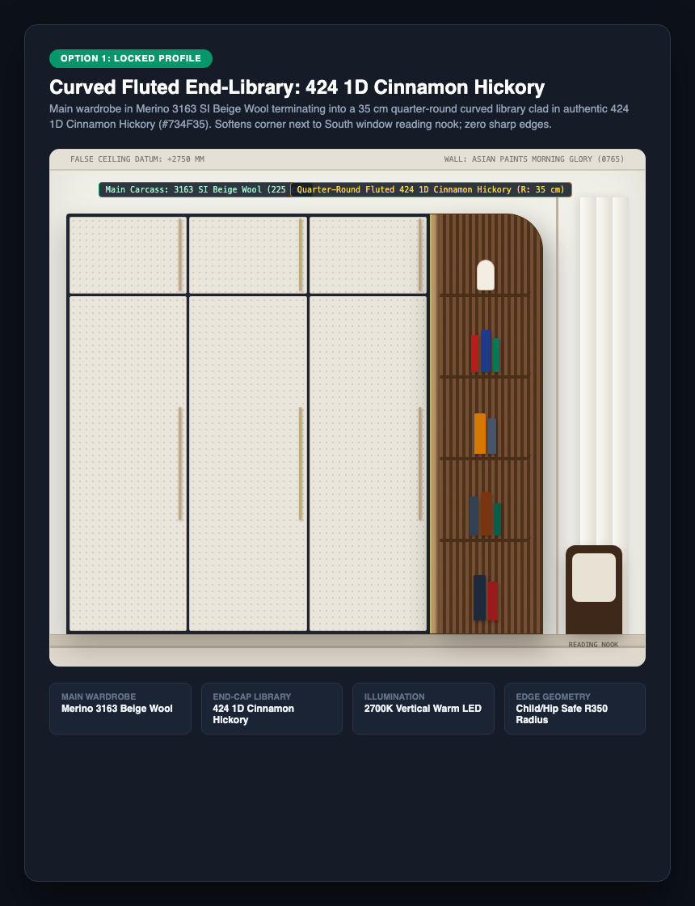

[[index|← Back to Home Overview]]

# Study & Guest Room (13'0" × 13'0")

Primary workspace for Samar (SDM at Amazon) and flexible guest suite. Houses the owned standing desk, Steelcase Amia ergonomic chair, integrated wardrobe end-shelf library, monitor task lighting, and a solid-wood guest sofa-bed (Custom CP Teak pull-out or Gulmohar Lane Berlin).

> **Clearance Rule:** Position the standing desk along the East wall facing North, **1/4 (~84 cm) from the South window curtain and 3/4 (~236 cm) from the NE room entrance**, with South window blackout drapery eliminating screen backlight glare.
> **Finishes Reference:** Wall finish references [[curtains-paint-finishes#definitive-room-by-room-color-palette]].

---

## Study & Guest Room Hardware & Furnishings

| Need | Tier 1: High-Quality VFM | Tier 2: High-Quality Unconstrained | Top Failure Mode & Reddit Insight |
| :--- | :--- | :--- | :--- |
| **BR-01 Wardrobe & Library** | **[Recommended]** **Homz Locked South Wall Run: East Bookshelf + 4-Door Wardrobe** (East-side open `424 1D Cinnamon Hickory` bookshelf directly beside South window `W2` + 4-door wardrobe extending West to SW toilet wall in `3163 SI Beige Wool` with [Spruce & Pop Claro](https://spruceandpop.com/products/claro-antique-brass-knurled-cabinet-drawer-knob-and-handle) in Antique Smoked Bronze, concealed 2700K LED wash) | [Century Club Prime BWP + Blum TIP-ON + Fluted Hickory Bookcase](https://www.google.com/search?q=Century+Club+Prime+BWP+%2B+Blum+TIP-ON) (Integrated LED shelf channels, dust-sealed glass returns, ~₹1.85L) | Open high-rise end-shelves gather fine dust; wipe weekly or seal bottom 2 tiers with fluted glass shutters while keeping top open tiers for active reading books. |
| **Sofa-Bed for Guests** | **[Recommended]** **Custom Seasoned CP Teak Pull-Out Sofa-Bed** (Kiln-dried solid wood frame, queen trundle, 8.8 durability, 8.8 overall, ₹68,000) | [Gulmohar Lane Berlin Fabric Sofa Cum Bed](https://www.gulmoharlane.com/products/berlin-fabric-sofa-cum-bed) (Kiln-dried hardwood frame, 188×193cm bed, bolt-on KD legs/arms, 8.6 overall, ₹1,26,900) / [Innovation Living CozyPad](https://www.innovationliving.asia/) (~₹1.85L) | Disqualified IKEA HOLMSUND (6.2 BIFL score; cheap pine frame splits under dynamic guest weight). Doorway Gate (880mm clear): mandate detachable legs/arms on Berlin so it enters BR-01 tilted on its back (860mm < 880mm). |
| **Window Reading Lounge Chair** | **[Recommended]** [IKEA POÄNG Armchair (Birch / Kelinge Beige)](https://www.ikea.com/in/en/p/poaeng-armchair-birch-veneer-kelinge-beige-s49625299/#content) + [IKEA POÄNG Footstool (Birch / Kelinge Beige)](https://www.ikea.com/in/en/cat/poaeng-series-07472/) (Matching wide-wale corduroy, washable covers, high-back + detached ottoman, 8.1 durability, 9.0 VFM, 8.3 overall, ₹14,480–₹18,880 set; optional ₹2k–₹2.5k local cotton/linen slipcover) | [Gulmohar Lane Candolim / Reims Wingback + Ottoman (Fabric)](https://www.gulmoharlane.com/collections/arm-chairs) (Kiln-dried hardwood frame, padded pleated arms, 114 cm high back, 8.6 durability, 5.1 VFM at $4.35\times$ under $k=1.25$, 8.0 overall, ~₹63,000) | Disqualify low-back accent chairs for multi-hour reading (cervical fatigue within 30 min) and `Ekornes Stressless` (₹2.47L+, fails $\text{VFM}_2 \ge 3.0$). `r/BuyItForLife` notes POÄNG wooden armrests feel hard if leaning sideways (add slim leather/wool arm wraps) and bolts need periodic tightening. *Kelinge* corduroy is plusher and richer than flat *Knisa*, though warmer than cotton-linen; run AC or use a cotton/linen throw for long sessions. |
| **Monitor Task Light** | [Quntis ScreenBar Pro (with Remote & Auto-Dimming)](https://www.amazon.in/dp/B08DKQ3JG1) (True asymmetric anti-glare optical lens, Ra95 CRI, USB-C, 8.4 durability, 8.5 overall, ₹4,599) | **[Recommended]** [BenQ ScreenBar Pro](https://www.amazon.in/dp/B0CZ94MB2R) (Ultrasonic presence auto-dimming, zero screen glare, Ra95, 9.0 durability, 6.3 VFM at $3.15\times$ under $k=1.25$, 8.5 overall, ₹14,490) / [BenQ ScreenBar Halo](https://www.google.com/search?q=BenQ+ScreenBar+Halo) (Wireless rotary controller, rear bias backlight, ₹19,990) | Disqualify `Baseus i-Wok` (lacks true asymmetric optical cutoff). Exact `8.5` overall tie under $k=1.25$ awards Tier 2 `BenQ ScreenBar Pro`; power via a dedicated `5V/1.5A` USB wall adapter (not monitor/PC USB ports) to prevent "SOS" flickering (`r/Monitors`). |
| **Monitor Arm Articulating Mount** | **[Recommended]** [Brateck / Jin Office Heavy-Duty Mechanical Spring Single Monitor Arm](https://jinoffice.com/) (Mechanical steel coil spring + heavy C-clamp/grommet mount for up to 34" / 12kg, zero gas cylinder leak risk, 8.5 durability, 8.6 overall, ₹3,999) | [Ergotron LX Desk Monitor Arm](https://www.ergotron.com/) (Patented Constant Force mechanical steel coiled spring, 10-year warranty, zero gas cylinder leaks, 9.5 durability, 4.8 VFM at $4.38\times$ price, 8.4 overall, ~₹17,500) | Disqualify cheap pressurized gas-strut arms (lose nitrogen within 18–24 months) and note that Ergotron-OEM `AmazonBasics` is discontinued. Mechanical steel coil-spring arms provide indefinite cycle life; Tier 1 Brateck/Jin mechanical arm wins under $k=1.25$ decay (8.6 vs 8.4 overall). |
| **Executive Standing Desk & Seating** | **[Recommended]** Owned Motorized Sit-Stand Desk (Dual-motor frame, 150×75 cm top, ₹0) + Owned [Steelcase Amia](https://www.steelcase.com/) upgraded with **[3" Soft Polyurethane Rollerblade Chair Castors (`11×22mm` stem)](https://www.amazon.in/s?k=rollerblade+office+chair+wheels+11x22mm)** (8.8 durability, 9.2 VFM, 9.0 overall, ₹1,499 set of 5) | Custom Solid White Oak Desktop on Linak DL6 Dual-Motor Frame (~₹85,000) + Herman Miller Embody (~₹1.65L) | Standard hard nylon PA6 chair wheels clatter over tile grout joints and scratch polished vitrified tile; soft polyurethane rollerblade wheels glide silently. Mount an under-desk cable spine so sit-stand elevation never pinches cords. |
| **Study & Home Office Printer (decided)** | **[Recommended]** [Brother HL-L2440DW Dual-Band Wi-Fi Auto-Duplex Laser](https://www.amazon.in/dp/B0D86RH9K2) (2.4/5 GHz Wi-Fi + AirPrint + USB 2.0, auto 2-sided duplex, 30 ppm, 3,000-page `TN-2570XL` inbox toner, 8.8 durability, 9.0 VFM, 8.8 overall, ₹14,990) / [Brother HL-L2321D Auto-Duplex Laser](https://www.amazon.in/dp/B00SHFP99W) (₹11,490, USB-only) | [Brother DCP-L2640DW / DCP-B7640DWB 3-in-1 Monochrome Laser AIO](https://www.brother.in/) (Flatbed Scanner + 50-Sheet ADF + Ethernet RJ45 + Wi-Fi + Auto-Duplex, 8.8 durability, 7.9 VFM at $1.43\times$, 8.7 overall, ₹19,500–₹23,500) / [Brother DCP-L3560CDW Color LED Laser AIO](https://www.brother.in/) (~₹36,000) | Disqualify liquid inkjets (`Epson EcoTank L3252`): printheads clog if left idle for 3 weeks (`r/printers`), whereas Brother dry toner never clogs over 6-month idle stretches. **Electrical Rule:** Laser fuser draws a **920W (7–9A) inrush spike**; plug directly into a wall 6A/16A socket (never into a computer UPS battery outlet). |

---

## [Suggestions] Room Layout & Spatial Architecture

Configured layout: NE entrance door, SW washroom door, West wall sofa-bed, East wall standing desk (facing North), and South wall library (left, next to window) with wardrobe run (right):

* **Executive Workspace (East Wall, Samar Sits Facing North):** Standing desk positioned against the East wall with Samar seated south of it facing North toward the entrance door. This command orientation provides direct visual control over entry without camera exposure to bed areas. Dual-layer drapery (sheer + blackout) on the South window stops midday screen reflection.
* **Guest Sleeping Zone (West Wall):** Custom Seasoned CP Teak Pull-Out Sofa-Bed (or Gulmohar Lane Berlin Sofa Cum Bed, 188 cm wide) placed flush along the solid West wall north of the SW washroom doorway. Fits cleanly within the 261 cm stretch from the NW corner to the bath opening. Expanding to 193 cm bed mode leaves 215 cm of walk clearance to the East wall.
* **Bookshelf Library (South Wall, Left / Next to Window):** Fluted `424 1D Cinnamon Hickory` open bookshelf (35 cm return) positioned on the left adjacent to the South window reveal. Eliminates a flat laminate gable end next to glazing while housing 80+ books in direct natural daylight.
* **Wardrobe Run (South Wall, Right):** Homz 4-door wardrobe finished in `3163 SI Beige Wool` extending West from the East-side Cinnamon Hickory bookshelf toward the SW toilet wall.
* **Window Reading Nook (South Wall Alcove):** Lounge armchair placed by the South window and bookshelf library. Natural South daylight for reading, direct arm-reach access to books, and 110 cm clearance from the desk chair.
* **Bathroom Circulation (Central-West Spine):** Unencumbered walking path runs from the NE entrance across the open center straight into the SW ensuite washroom, clearing the West-wall sofa-bed.
* **Brahmasthan:** Generous 180×160 cm open central floor zone kept clear of static furniture.



```
                                      [ NORTH ]
                  [ North Wall (296 cm Clear Stretch) ]          [ NE Entrance Door ]
+-----------------------------------------------------------------------------------+
| [ Guest Lounge & Sleeper ]                                     | (Inward Door     |
| West Wall (261 cm Clear)                                       |  Swing along     |
| Custom CP Teak / Berlin                                        |  East Wall)      |
| Sofa-Bed (188 × 104 cm,                                        +------------------+
|  193 cm Open Bed East)                                                            |
|                                                                [ Study Station ]  |
| [ WEST ]                                                       Executive Sit-Stand|
|                                                                SAMAR SITS FACING  |
|                                                                NORTH              |
|                                                                (Command View)     | [ EAST ]
|                                                                Screens face South |
|                                                                                   |
|                                                                [ SE Reading Nook ]|
| [ SW Bathroom Door ]                                           Lounge Armchair    |
| (Ensuite 5'0" × 7'11")   [ Book Shelf ]        [ South Wardrobe ] (IKEA POÄNG + Ott.)
| Door swings West         35cm Oak Return       Homz 3163 Beige |  Natural light   |
+--------------------------+---------------+======================+------------------+
                           [ South Window (3'11" Glazing) ]
                                      [ SOUTH ]
```

---

### BR-01 Wardrobe & Study Hardware Specification
* **Mid Swing Shutters (×3):** [Spruce & Pop Claro Solid Brass Pull](https://spruceandpop.com/products/claro-antique-brass-knurled-cabinet-drawer-knob-and-handle) in **Antique Smoked Bronze** (256mm CC / 295mm Total Length, ₹2,275 ea). Warm deep tone bridges `3163 SI Beige Wool` wardrobe doors with the `424 1D Cinnamon Hickory` fluted library return.
* **Bottom Drawers (×2):** [Spruce & Pop Claro Pull](https://spruceandpop.com/products/claro-antique-brass-knurled-cabinet-drawer-knob-and-handle) in **Antique Smoked Bronze** (128mm CC / 165mm Total Length, ₹1,275 ea).
* **Top Lofts (×3):** Concealed push-to-open Tip-On mechanical latches (strictly zero surface handles across all rooms).
