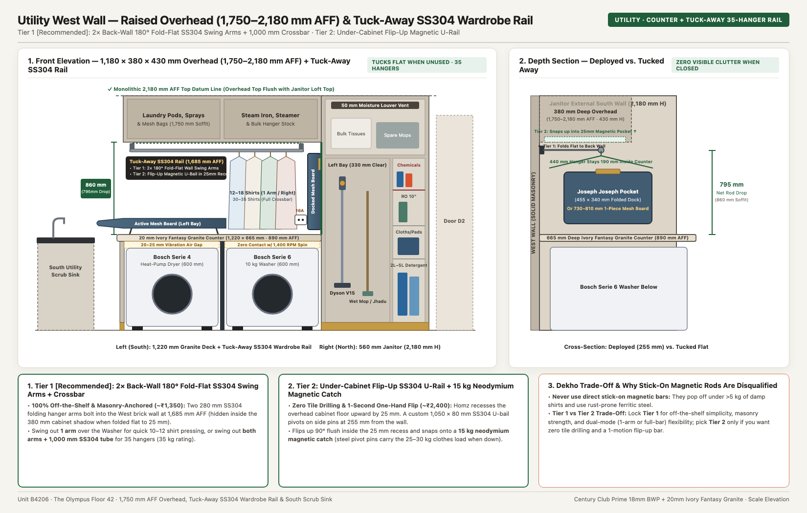

[[index|← Back to Home Overview]] · [[kitchen-laundry|Kitchen Spec]] · [[wardrobe-internal-storage#5-utility-janitor-tall-unit-560--520-mm--laundry-overhead-1180--380-mm|Janitor 65:35 Internals]]

# Utility & Laundry Balcony (4'11" × 13'1" / 1,500 × 3,980 mm)

Semi-wet laundry, ironing, and service zone off the Kitchen East wall (`D2`). Runs left-to-right along the West partition wall: **South Service Scrub Sink** $\rightarrow$ **Side-by-Side Bosch Heat-Pump Dryer + Front-Load Washer (`1,200 mm`) under a `1,220 × 665 mm` Ivory Fantasy Granite Counter (`890 mm` AFF) and `1,180 × 380 mm` Overhead Cabinet** $\rightarrow$ **North `560 × 520 mm` Janitor Tall Unit** beside door `D2`.

> **Internal Storage Reference:** For the `65:35` internal partition schedule of the `560 × 520 mm` Janitor Tall Unit (Dyson V15 bay + child-safe supply shelves), see [[wardrobe-internal-storage#5-utility-janitor-tall-unit-560--520-mm--laundry-overhead-1180--380-mm|Wardrobe & Utility Storage §5]].

Top reasons to reject common utility designs here: (1) cutting the fixed granite slab into a tapered ironing nose blocks garments from slipping underneath, traps steam condensation against cold stone, and creates a hip-strike hazard in the `835 mm` standing aisle; (2) hanging a fabric ironing wing on the Left (South) gable exposes it to haldi/grease splashes from the adjacent scrub sink (`~480 mm` away), while stowing the board *inside* the Janitor bay exposes it to damp mop odors; (3) under-counter pull-out swivel boards (`Häfele Ironfix`) add `+110 mm` height (`990 mm` AFF) and collide with the East parapet wall (`950 mm` throw vs `835 mm` aisle).

---

## 1. Utility & Laundry Hardware Matrix

| Need | Tier 1: High-Quality VFM | Tier 2: High-Quality Unconstrained | Top Failure Mode & Reddit Insight |
| :--- | :--- | :--- | :--- |
| **Washer (Front-Load, Side-by-Side) (decided)** | **[Recommended]** [Bosch WGA254ZSIN Serie 6 10kg 1400 RPM](https://www.bosch-home.in/product/WGA254ZSIN) (EcoSilence BLDC, AntiStain, 8.4 D, 9.0 VFM, 8.7 overall, ₹44,000 Elitehaus quote; right/North bay beside Janitor unit) / [Bosch WGA252ZSIN 10kg 1200 RPM](https://www.amazon.in/dp/B0DFCLM4QY) (8.3 D, ₹42,899–₹45,999) | [Bosch WGB256A0IN Serie 8 10kg 1600 RPM i-DOS](https://www.bosch-home.in/) (8.9 D, 7.0 VFM at $1.80\times$, 8.5 overall, ₹78,990) / [Miele W1 WWD 320 8kg](https://www.miele.in/) (Cast-iron weights, 9.4 D, 3.1 VFM, 8.0 overall, ~₹1,45,000) | Bosch welded tubs prevent bearing-only swaps; run monthly 60°C descaling cycles and fit an inline polyphosphate filter + 20-bar SS304 braided hose on the cold inlet. Place on structural tile with rubber pads on a dedicated 16A radial drop. |
| **Dryer (Heat Pump, Side-by-Side) (decided)** | **[Recommended]** [Bosch WQG2520XIN Serie 4 10kg Heat Pump](https://www.amazon.in/dp/B0GQTZ14ML) (EasyClean manual condenser door, 600W R290, AutoDry, left/South bay toward service sink, 8.5 D, 9.0 VFM, 8.7 overall, ₹64,000 Elitehaus quote / ₹67,740 Amazon) / [Siemens WQ45G209IN iQ500 9kg](https://www.siemens-home.bsh-group.in/) (8.4 D, ₹68,990) | [Miele T1 TWD 360 / TWJ 660 EcoDry Heat Pump](https://www.miele.in/) (PerfectDry conductance sensor, FragranceDos, 9.2 D, 5.8 VFM at $2.27\times$, 8.5 overall, ~₹1,45,000) | Serie 4 EasyClean door allows direct vacuuming of condenser coils. Disqualify `Bosch WQB245B0IN Serie 8` (₹92k): sealed 'SelfCleaning' condenser flushes lint into lower sump, baking sludge ('DR' error). Crack utility uPVC sash $\ge 50\text{mm}$ during runs. Dedicated 16A socket. |
| **Laundry Folding Countertop & Support Frame (`1,220 × 665 mm`)** | **[Recommended]** **Ivory Fantasy Indian Granite Slab (Kitchen Offcut Yield, `1,220 × 665 × 20 mm` at `890 mm` AFF)** + **25×40mm Powder-Coated MS/SS304 Center T-Post & Rear Angle Cleat** (2 coats Akemi Nano Sealer, R8 half-bullnose edge, 3×3mm underside drip groove, 60×150mm rear hose/plug grommet slot, 20–25mm vibration air gap, 9.0 D, 9.4 VFM, 9.0 overall, **~₹3,500** cutting & cleat labour) | [Cosentino Dekton / Caesarstone Quartz 20mm Utility Slab on Welded SS304 Frame](https://www.cosentino.com/) (9.3 D, 3.5 VFM at $5.7\times$ under $k=1.25$, 8.2 overall, ~₹20,000) | Never rest stone directly on 1,400 RPM machine top plates (transmits spin shock, cracking stone and crushing washer top PCB). Center 25×40mm steel T-post in the 20mm gap between Dryer and Washer prevents mid-span cracking. Bed slab on removable neutral silicone dabs (zero cement mortar) for slide-out servicing. |
| **Utility Service Scrub Sink & High-Arch Tap (South Wall, Separate from Kitchen Sink)** | **[Recommended]** **Retain Builder South-Wall Granite Service Counter & Deep SS304 Scrub Bowl** (or upgrade bowl to [Nirali / Carysil 24×18×10" 16G SS304 Utility Sink](https://carysilshop.com/collections/stainless-steel-sink), ₹7,500) + [Jaquar Florentine DZR Brass Swivel Sink Cock (`FLR-CHR-5359N`)](https://www.jaquar.com/) (360° high-arch spout clears 400mm tall buckets & *kadhais*, ₹2,650) + **110mm SS304 Basket Strainer & Smooth-Bore Rigid PVC P-Trap** (₹1,800; 8.8 D, 9.2 VFM, 8.9 overall, **₹4,450** upgrade on builder sink) | [Carysil / Franke 16G (1.2mm) Handmade AISI 304 Deep Scrub Sink on Matching Ivory Fantasy Granite Slab](https://carysilshop.com/collections/stainless-steel-sink) + [Kohler July Swivel Sink Spout + Viega Rigid Siphon](https://www.kohler.co.in/) (9.2 D, 5.1 VFM at $4.1\times$ under $k=1.25$, 8.3 overall, ~₹18,500) | Confirmed present on the Utility **South wall** (adjacent to `P-SHAFT-61` `50 mm` utility waste stack per GFC plan [[plans-drawings]]), completely separate from the internal Kitchen sink. Replace corrugated flexible drain hose with a rigid PVC P-trap + 110mm food-catch basket so pot-scrubbing grit never clogs the `50 mm` utility drain, and grind a 3–5mm underside drip groove. |
| **Tabletop Mesh Ironing Board (External Janitor South-Wall Dock)** | [Bonita / HomeStrap Heavy-Duty Perforated Steel Mesh Tabletop Board (`810 × 310 mm`)](https://www.google.com/search?q=Bonita+Tabletop+Ironing+Board+Perforated+Steel+Mesh) (35mm foldable steel legs, cotton/felt pad, wall hook, 8.1 D, 9.0 VFM, 8.2 overall, ₹2,999) / *Budget 1-Piece:* [IKEA JÄLL Tabletop Board (`730 × 320 mm`)](https://www.ikea.com/in/en/p/jaell-ironing-board-table-20242890/) (7.6 D, ₹599; hangs flat inside the `830 mm` clear backsplash zone below the raised `1,720 mm` AFF overhead) | **[Recommended]** [Joseph Joseph Pocket Folding Plus Tabletop Ironing Board (`900 × 330 mm`)](https://www.amazon.in/Joseph-Pocket-Folding-Ironing-Board/dp/B0D2L822K3) (Perforated steam mesh, 35mm non-slip legs, integrated silicone iron bay, folds in half to **`455 × 340 × 155 mm`** with dedicated screw-on wall bracket, 8.8 D, 5.3 VFM at $2.50\times$ under $k=2.5$, 8.3 overall, ₹7,499) | **External South-Wall Dock (`830 mm` Zone):** Raising the overhead cabinet to `1,720 mm` AFF underside opens an `830 × 520 mm` zone on the **external South-facing side wall of the Janitor unit**, fitting either the folded `Joseph Joseph Pocket` (`455 mm`) or a 1-piece `730–810 mm` board with zero mop odor, `1,100 mm` separation from the scrub sink, and zero overhead width cut. Disqualified `Häfele Ironfix` (₹16.5k, clashes with `835 mm` aisle). |
| **Under-Cabinet Valet Rod & Iron Power Point** | **[Recommended]** [Ebco / Häfele 300mm Retractable SS304 Pull-Out Valet Hanger Rod](https://www.google.com/search?q=Ebco+Hafele+300mm+Retractable+Pull+Out+Valet+Hanger+Rod) (Mounted under Right-Center of `1,180×380mm` overhead at **`1,720 mm` AFF** over the Washer bay, giving **`830 mm` clear hanging drop**, 8.8 D, 9.2 VFM, 8.8 overall, **₹650**) + **16A/6A Switched Steam-Iron Socket at `1,020 mm` AFF** (by North Janitor gable, routed via Janitor carcass with zero wall chasing, **~₹850**) | **Tier 2: None justified ($\text{VFM} < 3.0$)** — Lock Tier 1 | Raising the `460 mm` overhead to `1,720–2,180 mm` AFF (flush with the `2,180 mm` Janitor top) prevents adult shirts (`~780–820 mm` on hanger) from dragging on the `890 mm` granite counter. Mounting the valet rod over the **Right/Washer bay** keeps hung shirts clear of the active ironing board on the Left. |
| **Kitchen-Utility Door Wind Restraint (`D2`)** | [Häfele DCL 110 Overhead Hydraulic Closer (EN 3/4, Backcheck, Standard Arm)](https://www.hafeleindia.com/) (8.4 D, 9.0 VFM, 8.5 overall, ₹4,500–₹5,500) / [Godrej / Ozone Heavy-Duty Backcheck Closer (80–120 kg)](https://www.godrejenterprises.com/) (₹2,500–₹4,000) | **[Recommended]** [Dormakaba TS 73 V Overhead Hydraulic Closer (EN 2–4, "Thinking" Backcheck, Standard Arm)](https://www.dormakaba.com/) (Thermostatic oil resists 45°C weep, 9.4 D, 7.3 VFM at $1.7\times$, 8.7 overall, ₹7,500–₹9,500) + floor rubber dome stop (₹650) | Disqualify foot kickdown stays (`<7.0`, skid on wet tile, rack thin aluminum stiles), non-BC closers (`TS 68`, `DC 140`), and **Hold-Open Arms** (Floor 42 gusts snap HOA detents). Mount `TS 73 V` on **dry Kitchen interior side** via aluminum **drop plate + M5/M6 SS304 rivnuts** (never self-tapping screws), and verify **3× SS304 hinges + EPDM gasket**. |
| **Utility Parapet Glazing Enclosure (Floor 42)** | **[Recommended]** **Sumadhura FM White uPVC 3-Track Sliding Enclosure** (Vendor: **UPVC Works Kukatpally** per reference/olympus-vendor-directory; $\ge 1.5\text{mm}$ GI core, $\ge 6\text{mm}$ toughened glass on 2 tracks + 1 SS304 mesh track, Fischer sleeve anchors $\le 450\text{mm}$ pitch, storm weep flaps, 8.8 D, 9.0 VFM, 8.8 overall, **~₹28,000–₹35,000**) | **Tier 2: None justified (FM Exterior Facade Lock)** — Lock Tier 1 | Sumadhura FM strictly mandates **White uPVC only** to preserve tower elevation uniformity (non-matching aluminum is rejected; reference/olympus-community-qa). Keep slider cracked $\ge 50\text{mm}$ on the SS304 mesh track during heat-pump dryer cycles and for passive BGL gas meter ventilation. |

---

## 2. Spatial Architecture & External South-Gable Ironing Dock

### Site Execution & Plumbing Guardrails
1. **Raised `1,720 mm` AFF Overhead Datum & External South-Wall Ironing Dock (`830 mm` Clear Zone):**
   * **Flush Top Datum (`2,180 mm` AFF):** Instruct Homz to mount the `1,180 × 380 × 460 mm` Laundry Overhead at **`1,720–2,180 mm` AFF** (top flush with the `2,180 mm` Janitor Tall Unit; do not push higher than `1,720 mm` AFF underside so `5L` detergent jugs on the `1,738 mm` bottom shelf remain within safe flat-footed reach over the `665 mm` counter).
   * **830 mm Hanging Drop & Universal Board Dock:** The `830 mm` vertical gap between the `890 mm` granite counter and `1,720 mm` overhead cabinet allows full-length adult shirts (`~780–820 mm` on hanger) to hang free from the **Right-Center Valet Rod (above the Washer bay, clear of the Left ironing board)** and lets **either** the folded `Joseph Joseph Pocket` (`455 × 340 mm`) **or** a 1-piece `730–810 mm` tabletop mesh board dock directly on the Janitor unit's external South wall with zero cabinet width modification.
2. **Slab Depth (`665 mm`) & Aisle Clearance (`835 mm`):** The `Bosch WQG2520XIN` dryer (`613 mm` body + rear hose/plug) requires a `665 mm` deep granite top, leaving an `835 mm` clear standing aisle inside the `1,500 mm` wide Utility. Core a `60 × 150 mm` rear right grommet slot so 16A plugs and the cold-water angle valve remain reachable from above.
3. **South-Wall Utility Scrub Sink (`P-SHAFT-61`) & Washer Plumbing (`P-SHAFT-74`):** Retain the dedicated **South-wall Utility service sink** (separate from the Kitchen sink) for heavy cookware scrubbing, bucket filling, and hand-washing; upgrade to a `110 mm` SS304 deep basket strainer, rigid PVC P-trap, and DZR brass stopcock + `360°` high-arch swivel tap. Fit a 20-bar burst-rated SS304 braided inlet hose and inline polyphosphate scale cartridge strictly on the cold-water feed of the `Bosch WGA254ZSIN` washer. Test `P-SHAFT-74` metered feed pressure and install a `Zoloto Art. 1040B` forged brass PRV only if static pressure exceeds `4.5 bar` ([[gotchas-and-tips#1-plumbing-hydrostatic-pressure--wet-services]]).