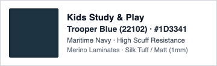
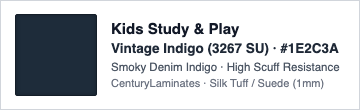
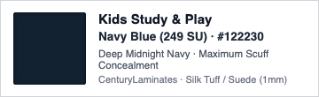
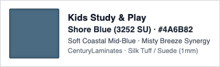

[[index|← Back to Home Overview]]

# Soft Furnishings, Window Drapery, Solar Glazing & Paints

Master specification for whole-home low-sheen paint palette, Homz laminate finishes, ceiling-recessed double-channel drapery, and East-facing solar UV protection films.

---

## 1. Interior Wall Paint & Color Palette

Cohesive Japandi architectural palette calibrated for Floor 42 high-rise natural light (combining North diffuse light and East morning glare). Pure stark whites cause clinical glare; all tones are warm low-sheen off-whites and organic neutrals (LRV 70–78).

| Component | Tier 1: High-Quality VFM | Tier 2: High-Quality Unconstrained | Top Failure Mode & Reddit Insight |
| :--- | :--- | :--- | :--- |
| **All Walls & Ceilings** | **[Recommended]** [Asian Paints Royale Luxury Emulsion (Soft Matte)](https://www.amazon.in/s?k=Asian+Paints+Royale+Luxury+Emulsion) (Teflon surface protector, anti-bacterial, washable, ~₹420/L) / [Dulux Velvet Touch Diamond Glo / Pearl Glo](https://www.amazon.in/s?k=Dulux+Velvet+Touch+Diamond+Glo) (High scrub resistance, zero added lead/mercury, ~₹410/L) | [Asian Paints Royale Aspira / Royale Glitz Ultra Matt](https://www.amazon.in/s?k=Asian+Paints+Royale+Aspira) (Crack-bridging elastomeric membrane, 5-yr warranty, ultra-washable dead matte, ~₹680/L) / [Benjamin Moore Aura Interior Matte / Eggshell (via Authorized India Studio)](https://www.amazon.in/s?k=Benjamin+Moore+Aura+Interior+Matte) (Color Lock zero-fade pigment, zero VOC, ~₹1,200/L) | Direct application on unprimed gypsum flakes within 6 months. High-gloss finishes highlight surface undulations under grazing cove LED lights; use matte or low-sheen eggshell only. |

### Definitive Room-by-Room Color Palette

| Room / Zone | Recommended Tone & Code (Asian Paints) | Swatch (Color) | Interior Designer Rationale & Cabinet Synergy |
| :--- | :--- | :--- | :--- |
| **Whole-Home Base Envelope** (Foyer, Living, Dining, Drawing, Master Bed, Study BR-01, Gurudwara BR-03) | **Morning Glory (0765)** (`#F0EFE8`, LRV 74) |  | Primary Japandi neutral canvas in Royale Luxury Emulsion (Soft Matte). Unifies all social and private spaces, harmonizes with `424 Cinnamon Hickory`, `3163 Beige Wool`, and Persian carpet.  **Living Room Accent Note:** If you want subtle depth without coarse grit, apply a smooth, burnished limewash or mineral Roman clay. This gives a delicate, cloudy suede feel with zero grit, zero glare, and zero dust trapping. |
| **Kitchen & Utility** | **Morning Glory (0765)** (`#F0EFE8`, LRV 74) · Royale Shyne |  | Identical color formula in high-scrub formulation. Cleanly links `3174 Brown Sugar` base and `#F4F2EB` off-white overheads/lofts without color breaks. |
| **BR-02 (Kabir's Room)** | **Misty Breeze (8307)** (`#B2C2CC`, LRV 54) |  | Light, desaturated coastal grey-blue. Dedicated playful accent paired with `424 Cinnamon Hickory` and blue tandem base; washable Teflon emulsion. |

---

## 2. Locked Homz Laminate Palette & Mirrors

| Zone / Joinery Unit | Main Shutter Finish & Code | Swatch (Color) | Accent / Niche Tone | Hardware & Profile Standard |
| :--- | :--- | :--- | :--- | :--- |
| **Living TV Unit & Panel** | Base: `424 1D Cinnamon Hickory` |   | Panel: `4929 LU Blanco Gold Marble` + Sofa-back texture paint |
| **Dining Vanity & Bookshelf** | Bookshelf: `424 1D Cinnamon Hickory` · Walk-in: `3163 SI Beige Wool` |   | Common vanity with **Robot Vacuum bay**; room-matched hidden doors |
| **Kitchen Cabinets** | **Base:** `3174 LU Brown Sugar` **Wall & Lofts:** **Warm Off-White (`#F4F2EB`)** |   | Light-shade Indian granite worktop (owner-sourced) + `0.8 mm Off-White` liner |
| **Master Suite & Wardrobes** | `3163 SI Beige Wool` (Wardrobes & Dresser) |  | Tall dresser with full-height dome mirror + Bed-back texture paint | [Spruce & Pop Claro Solid Brass](https://spruceandpop.com/products/claro-antique-brass-knurled-cabinet-drawer-knob-and-handle) in Brushed Satin Brass (256mm doors, 128mm drawers) + Blum soft-close |
| **BR-02 Kabir's Wardrobe** | `3163 SI Beige Wool` (Upper shutters & lofts) |  | Leftmost Niche: Wall-to-wall `424 1D Cinnamon Hickory` (no bottom drawers) Base Band: 4 blue tandem drawers under wardrobe shutters (**Decision Pending:** Century 3267 SU vs 249 SU vs 3252 SU vs Merino 22102)   | Look Mumma solid acacia elephant handles (M4 machine bolts) + Blum soft-close |

### Open Decision: Kabir's Wardrobe Base Tandem Drawer Laminate

Consolidating the base band to CenturyLaminates eliminates split-procurement between Merino and Century. Always mandate **Suede (`SU`)**; high-gloss (`LU`) shows immediate micro-abrasions and shoe scuffs on low drawers.

| Priority / Option | Laminate Code & Finish | Swatch (Color) | Tone & Palette Synergy | Key Trade-off & Why to Reject |
| :--- | :--- | :--- | :--- | :--- |
| **1. Recommended** | **Century `3267 SU` Vintage Indigo** (1.0 mm Suede) |  | Smoky denim indigo (`#1E2C3A`). Best aesthetic bridge between Misty Breeze walls (`#B2C2CC`), Beige Wool (`#D8CFBC`), and roasted Cinnamon Hickory (`#744F36`). Timeless into teenage years. | **Lead time:** If dealer does not carry floor stock, requires a 3–4 day dealer indent. |
| **2. High Contrast** | **Century `249 SU` Navy Blue** (1.0 mm Suede) |  | Deep midnight navy (`#122230`). Direct 1:1 match to Merino 22102 Trooper Blue. Maximum kick-scuff concealment. | **Sharpness:** High visual jump against Beige Wool; less subtle than smoky indigo. Universal local stock. |
| **3. Tonal Coastal** | **Century `3252 SU` Shore Blue** (1.0 mm Suede) |  | Soft muted coastal mid-blue (`#4A6B82`). Direct color family match with Misty Breeze walls for a gentle, playful feel. | **Scuff visibility:** Lighter mid-tone shows dirt and shoe scuffs much faster than dark navy or indigo. |
| **Baseline Benchmark** | **Merino `22102` Trooper Blue** (1.0 mm Matt) |  | Deep maritime navy (`#1D3341`). Original baseline spec. | **Procurement friction:** Splits order to a separate Merino distributor for just two sheets while all other millwork is Century. |

---

## 3. Window Treatments & Solar Glazing Matrix

| Need | Tier 1: High-Quality VFM | Tier 2: High-Quality Unconstrained | Top Failure Mode & Reddit Insight |
| :--- | :--- | :--- | :--- |
| **Window Drapery (6 Openings)** | **[Recommended]** [D'Decor / Sarom Performance Fabrics](https://www.ddecor.com/search?q=D%27Decor) (Blue Wool 6+ lightfastness, 2.25× pinch pleat + detachable 3-pass blackout, ~₹1.1L–1.5L via Bhavani Furnishings) / [GM Fabrics / RR Decor Textured Slub Weaves + Voile Sheers](https://www.amazon.in/s?k=GM+Fabrics) (~₹1.05L) | [Pure European Linen + 3-Pass Acoustic Thermal Blackout](https://www.amazon.in/s?k=Pure+European+Linen+%2B+3-Pass+Acoustic+Thermal+Blackout) (Belgian/Italian flax linen, lead-weighted bottom hems, S-wave / Euro pleat, ~₹2.2L–2.8L via Bhavani / Neo Fabrique) / [Atmosphere / Nilaya by Asian Paints Luxury Drapery](https://www.amazon.in/s?k=Atmosphere) (~₹2.5L) | Ready-made online panels (250cm) fall 30cm short of high-rise 2.8m finished drops; cheap non-woven blackout linings disintegrate after 2 laundry cycles. Always demand detachable 3-pass woven blackout lining. |
| **Curtain Track System** | **[Recommended]** [IKEA VIDGA Double Curtain Track Rail](https://www.ikea.com/in/en/search/?q=VIDGA+Double+Curtain+Track+Rail) (Ceiling mounted aluminum, UV-stabilized nylon gliders, draw wands, ₹180–250/ft) / [MAC / Marvel Heavy-Duty Powder-Coated Hospital/Hotel Ripple-Fold Track](https://www.amazon.in/s?k=MAC) (Ball-bearing wheeled runners, ₹240/ft) | [Silent Gliss 6870 / 3840 Recessed Architectural Profile](https://www.amazon.in/s?k=Silent+Gliss+6870) (Swiss 2-component 2C gliders, zero acoustic friction, silicone-lubricated channel, ₹850/ft) / [Forest KS / DS-XL Recessed S-Wave Track System](https://www.amazon.in/s?k=Forest+KS) (Dutch patented easyflex wave tape carrier, ₹680/ft) | Fastening heavy lined drapes directly into unreinforced gypsum board pulls screws out; tracks must screw into 18mm BWP ply backing inside Homz pelmet. |
| **Master Suite Automated Drapery** | [Aqara Curtain Driver E1 (Track Version) ×2](https://www.aqara.com/en/product/curtain-driver-e1/) (Clips onto U/I-rail in 30s, USB-C 1-yr battery, ₹15,220 pair) / [SwitchBot Curtain 3](https://www.amazon.in/s?k=SwitchBot+Curtain+3) (₹16,500 pair) | **[Recommended]** [Somfy Glydea Ultra 60e RTS / Zigbee Motorized Track](https://www.amazon.in/s?k=Somfy+Glydea+Ultra+60e+RTS) (Concealed 230V wired motor, whisper-quiet <30dB, touch-motion tug start, manual override, ₹38,500) / [Aqara C3 Hardwired Track](https://www.amazon.in/s?k=Aqara+Smart+Curtain+Motor+C3) (₹28,500) | Clip-on battery rollers slip on tracks, buzz loudly, and need ladder recharges every 2 months; 230V Somfy hardwired track pulls heavy lined blackout curtains silently (<30dB). |
| **Solar Heat & UV Glazing (East Glass)** | [Garware Suncontrol High-Performance Ice Cool / Daylight Film](https://www.amazon.in/s?k=Garware+Suncontrol+High-Performance+Ice+Cool) (70% VLT, 55% TSER, ₹180/sq ft) / [Llumar N1065](https://www.amazon.in/s?k=Llumar) (₹260/sq ft) | **[Recommended]** [3M Prestige 70 Optical Film](https://www.3mindia.in/3M/en_IN/p/d/v000080644/) (200+ non-metallic nano-layers, 97% infrared heat rejection, 99.9% UV block, zero night mirror effect, ₹580/sq ft) / [Saint-Gobain Solar Gard](https://www.amazon.in/s?k=Saint-Gobain+Solar+Gard+Panorama+Hilite+70) (₹520/sq ft) | Rejects 97% infrared heat and 99.9% UV to protect the Persian carpet and solid timber from bleaching, with zero interior night mirror reflection. |