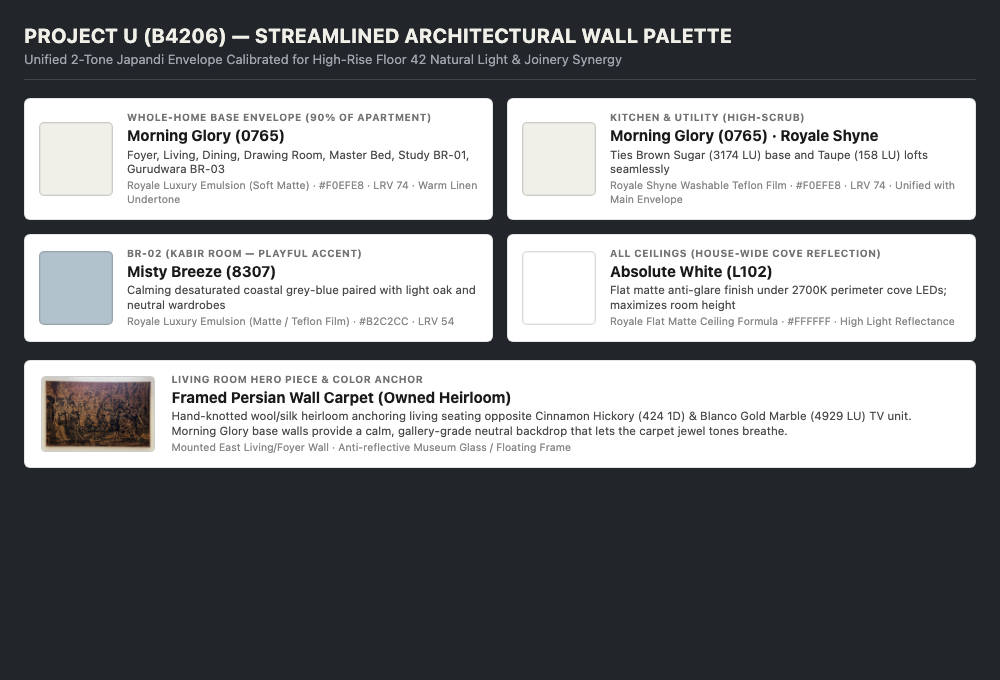
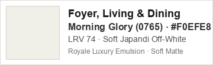
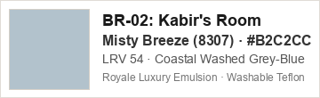
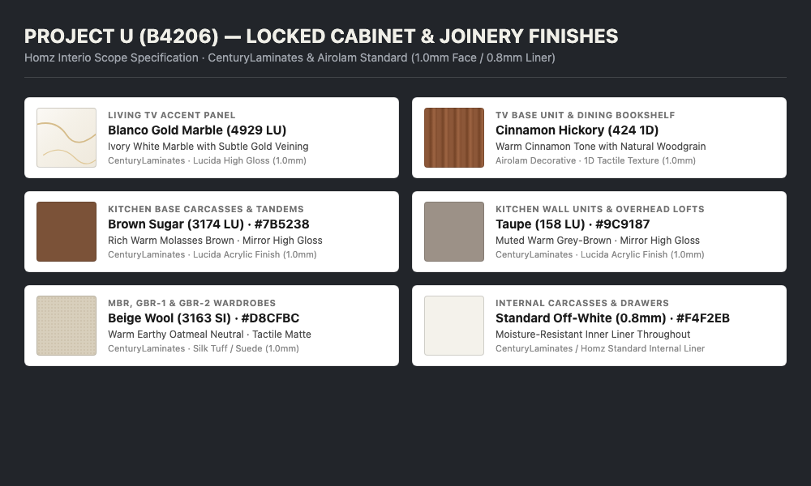
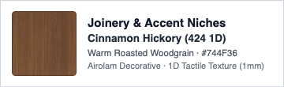
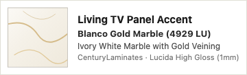
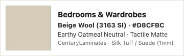
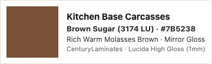
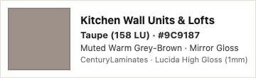
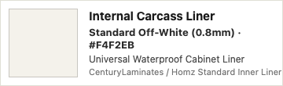

[[u-setup-index]]

### §7 Interior Finishes, Window Treatments & Solar Control

**Answer:** Ceiling-recessed double-channel curtain tracks across all 6 window assemblies with sheer + 100% 3-pass blackout linings. Homz builds a 150 mm ply-backed pelmet pocket before false ceiling boarding. Custom-stitched locally in Hyderabad by Bhavani Furnishings or Neo Fabrique with branded mill codes. **Every line item presents High-Quality VFM first, followed by High-Quality Unconstrained.**

#### Window Treatments & Solar Glazing Matrix

| Need | Tier 1: High-Quality VFM | Tier 2: High-Quality Unconstrained | Top Failure Mode & Reddit Insight |
| :--- | :--- | :--- | :--- |
| **Window Drapery (6 Openings)** | [Sarom / D'Decor Performance Fabrics](https://www.ddecor.com/curtains) (Blue Wool 6+ lightfastness, pinch pleat at 2.25×, ~₹1.1L–1.5L) | [Pure European Linen + 3-Pass Thermal Blackout](https://bhavanifurnishings.com/curtains/) (Heavy drape, weighted corners, ~₹2.2L–2.8L) | Ready-made online panels (250cm) fall 30cm short of high-rise 2.8m finished drops; cheap non-woven blackout linings disintegrate after 2 laundry cycles. Always demand detachable 3-pass lining. |
| **Curtain Track System** | [IKEA VIDGA Double Curtain Track Rail](https://www.ikea.com/in/en/cat/vidga-system-18891/) (Ceiling mounted, nylon gliders, wands, ₹180–250/ft) | [Silent Gliss 6870 Recessed Architectural Profile](https://www.silentgliss.com/products/curtain-track-systems/hand-operated/6870/) (Swiss two-component gliders, zero acoustic friction, ₹850/ft) | Fastening heavy lined drapes directly into unreinforced gypsum board pulls screws out; tracks must screw into 18mm BWP ply backing inside Homz pelmet. |
| **Master Suite Automated Drapery** | [Aqara Curtain Driver E1 (Track Version)](https://in.modo.store/products/aqara-curtain-driver-e1) (Rechargeable USB-C, Zigbee 3.0, ₹15,220) | [Somfy Glydea Ultra 60e RTS Motorized Track](https://www.somfy.co.in/products/curtains/glydea-ultra) (Concealed 230V wired motor, whisper-quiet <30dB, ₹38,500) | Pulling heavy 2.25× lined blackouts drains battery motors in under 6 weeks; ensure gliders run with zero mechanical friction, or route 230V power to pelmet. |
| **Solar Heat & UV Glazing (East Glass)** | [Garware Suncontrol High-Performance Film](https://garwarehitechfilms.com/architectural-films/) (70% VLT, 55% TSER heat rejection, ₹180/sq ft) | [3M Prestige 70 Spectrally Selective Film](https://www.3mindia.in/3M/en_IN/p/d/v000080644/) (Non-metallic nano-layer, 97% IR rejection, zero mirror effect, ₹580/sq ft) | Dark tinted metallic films cause thermal stress cracking on double-glazed low-E glass; specify non-metallic spectrally selective films only. |

---

### Architectural Pelmet & Measurement Protocol
* **Pelmet Dimensions:** Homz must frame a minimum $150\text{ mm W} \times 120\text{ mm D}$ concealed ceiling recess pocket with an 18 mm BWP plywood mounting base behind the gypsum drop.
* **Double Track Spacing:** Maintain $\ge 75\text{ mm}$ center-to-center spacing between the sheer track and blackout track to prevent heading friction during movement.
* **Measurement Timing:** Conduct final laser window measurements only after false ceiling gypsum framing, electrical pelmet wiring, and finished flooring tiles are complete.
* **Fullness Specification:** Mandate 2.25× to 2.5× fabric fullness with hand-stitched weighted lead bottom corners to ensure straight vertical pleat drops.

**Skip List:** Eyelet/grommet rings (light bleeds through top holes), house-brand uncertified dealer fabrics (no dye lot traceability), dark reflective mirror films on high-rise residential glass.

---

### §7.2 Interior Wall Paint & Color Palette (Designer & Reddit Standard)

**Answer:** Cohesive Japandi architectural palette calibrated for Floor 42 high-rise natural light (combining North diffuse light and East morning glare). Pure stark whites cause clinical glare; all tones are warm low-sheen off-whites and organic neutrals (LRV 70–78). All wall paint recommendations live definitively in this section.

#### Wall Finish Specification Matrix

| Component | Tier 1: High-Quality VFM | Tier 2: High-Quality Unconstrained | Top Failure Mode & Reddit Insight |
| :--- | :--- | :--- | :--- |
| **All Walls & Ceilings** | [Asian Paints Royale Luxury Emulsion](https://www.asianpaints.com) (Teflon surface protector, soft sheen/matte, ~₹420/L) | [Asian Paints Royale Aspira](https://www.asianpaints.com) / [Benjamin Moore Aura](https://www.benjaminmoore.com) (Crack-bridging, ultra-washable, matte finish, ~₹680–1,200/L) | Direct application on unprimed gypsum flakes within 6 months. High-gloss finishes highlight surface undulations under grazing cove LED lights; use matte or low-sheen eggshell only. |

#### Preparation & Application Protocol
* **Gypsum & Joint Prep:** 1 coat alkali-resistant primer $\rightarrow$ 2 coats fine acrylic putty (sanded with 220/320 grit mesh) $\rightarrow$ 1 coat intermediate primer $\rightarrow$ 2 top coats Royale emulsion.
* **Ceiling Paint Rule:** Never apply stark pure white on ceilings against warm off-white walls (creates a harsh dingy contrast). Tint ceiling paint with 50% dilution of wall formula, or use Asian Paints *Absolute White (L102)* flat matte to soften transitions and raise perceived room height.
* **Sheen Strategy:** Low-Sheen Eggshell / Soft Matte across all living/bed areas to mask drywall joints under perimeter cove LEDs. Royale Shyne reserved strictly for high-scrub zones (Kitchen & Utility).

#### Definitive Room-by-Room Color Palette

| Room / Zone | Recommended Tone & Code (Asian Paints) | Swatch (Color) | Interior Designer Rationale & Cabinet Synergy |
| :--- | :--- | :--- | :--- |
| **Whole-Home Base Envelope** (Foyer, Living, Dining, Drawing, Master Bed, Study BR-01, Gurudwara BR-03) | **Morning Glory (0765)** (`#F0EFE8`, LRV 74) |  | Primary Japandi neutral canvas. Unifies all social and private spaces, harmonizes with `424 Cinnamon Hickory`, `3163 Beige Wool`, and Persian carpet. Replaces dark accents with continuous light reflection. |
| **Kitchen & Utility** | **Morning Glory (0765)** (`#F0EFE8`, LRV 74) · Royale Shyne |  | Identical color formula in high-scrub formulation. Cleanly links `3174 Brown Sugar` base and `158 Taupe` lofts without color breaks. |
| **BR-02 (Kabir's Room)** | **Misty Breeze (8307)** (`#B2C2CC`, LRV 54) |  | Light, desaturated coastal grey-blue. Dedicated playful accent paired with light oak joinery; washable Teflon emulsion. |

---

### §7.3 Locked Homz Laminate Schedule, Mirrors & Wall Textures

**Answer:** Warm wood-grain and matte neutral laminate palette finalized with Homz Interio (`0.8 mm off-white` internal liner throughout; soft-close hinges standard excluding lofts).

| Zone / Joinery Unit | Main Shutter Finish & Code | Swatch (Color) | Accent / Niche Tone | Hardware & Profile Standard | Reddit & SME Failure-Mode Guardrail |
| :--- | :--- | :--- | :--- | :--- | :--- |
| **Living TV Unit & Panel** | Base: `424 1D Cinnamon Hickory` |   | Panel: `4929 LU Blanco Gold Marble` + Sofa-back texture paint | Soft-close drawers; concealed cable raceway for Sonos Arc Ultra | Route 50mm PVC conduit behind `4929 LU` panel before mounting; exposed HDMI/power cords ruin marble laminate visual. |
| **Dining Vanity, Bookshelf & Walk-in** | Bookshelf: `424 1D Cinnamon Hickory` · Walk-in: `3163 SI Beige Wool` |   | Common vanity with **Robot Vacuum bay**; room-matched hidden doors | Zero-threshold bottom garage (`≥150mm` height + internal 6A socket) | Standard vanity plinths trap robot vacuums; omit bottom toe-kick at dock bay. Use 4× SS304 ball-bearing hinges on heavy hidden doors to prevent sagging. |
| **Kitchen Base & Tandem Drawers** | `3174 LU Brown Sugar` (Base carcasses) |  | Light-shade Indian granite worktop (owner-sourced) | 2 tandem below hob + 3 drawers each side of sink + 1 tandem replacing wicker | Homz quotes normal-close channels as standard; mandate soft-close 50–70kg tandem runners in contract rider. Drill rear air vents in potato/onion drawer. |
| **Kitchen Wall Units & Lofts** | `158 LU Taupe` (Overheads & lofts) |   | `0.8 mm Off-White` internal laminate | Soft-close hinges on wall units; standard stays on lofts | Seal sink-base floor panel with aluminum foil tape / PVC mat to protect `0.8 mm` liner from RO/trap drips. |
| **Master Bedroom (MBR)** | `3163 SI Beige Wool` (Wardrobes & Dresser) |  | Tall dresser with full-height dome mirror + Bed-back texture paint | Soft-close hinges; internal tension straightener on tall doors | Anchor full-height dresser mirror to 12mm BWP ply backing with neutral-cure silicone. |
| **GBR / BR-01 (Study Room)** | `3163 SI Beige Wool` |  | Single shutter shifted toward study unit + dome mirror above | Soft-close hinges; concealed wire pass-through at study edge | Ensure shifted shutter clears standing desk travel range (72–120 cm height) without collision. |
| **GBR-2 / BR-03 (Gurudwara)** | `3163 SI Beige Wool` |  | Gold frame with clear glass middle shutter | Soft-close hinges; dust seal strip on glass frame | Toughened 5mm clear glass required inside gold profile to prevent rattle during balcony cross-breeze. |
| **KBR (Kabir) & Washrooms** | **TBD** (Recommend 70/20/10 neutral rule for KBR) | — | Store room: Overhead loft included in scope | Child-safe soft-close dampers on all KBR drawers | Reject cartoon laminates in KBR; mandate BWP marine ply + waterproof PVC edge tape for all washroom vanity cabinets. |

* **House-Wide Mirror Standard:** All mirrors feature a **dome-shaped top arch**. Use 5mm Saint-Gobain copper-free silver mirror bonded with neutral-cure alkoxy silicone (acidic silicone causes black edge rot).
* **Edge-Banding Rule:** Apply 2.0 mm solid-color high-impact PVC edge tape via factory PUR hot-melt edge bander. Reject manual solvent glue on shutter edges.
* **Cleaning Protocol:** Clean anti-fingerprint surfaces with microfiber cloths damp with 10% mild dish soap solution; reject acetone or chlorinated thinners.

**Detail →** [[u-setup-interiors-detail]] · [[u-setup-rooms]]