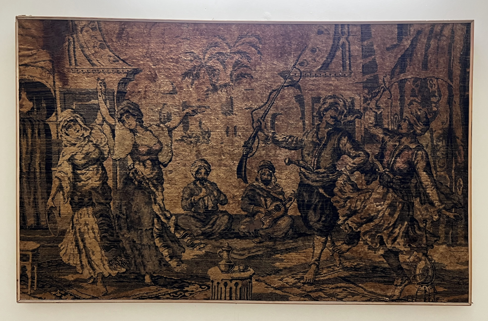

[[u-setup-index]]

### §12 Room by Room Loose Furniture & Millwork

**Answer:** Homz executes all fixed modular joinery (Kitchen, Wardrobes in `3163 SI Beige Wool`, Living TV unit in `424 1D`/`4929 LU`, Dining vanity with robot bay + bookshelf in `424 1D`, MBR tall dresser, Store loft, hidden doors, and dome-top mirrors). Procure all loose seating, beds, and dining tables directly from [Phantom Hands](https://phantomhands.in), [Alankaram](https://www.alankaram.in), [Spin](https://madewithspin.com), [Orange Tree](https://www.orangetree.in), and IKEA. **Every line item presents High-Quality VFM first, followed by High-Quality Unconstrained.**

*Site Constraint:* Measure Olympus service lift car and corridor turns before ordering items $>2.1\text{ m}$. Mandate knock-down (KD) bolted assemblies for large tables and sofas to avoid stairwell jamming.
*Finishes & Fixtures Reference:* Room wall colors reference [[u-setup-interiors#definitive-room-by-room-color-palette]]. BLDC ceiling fan sizing and siting rules reference [[u-setup-smart-home#bldc-ceiling-fan-specifications--siting-rules-designer--reddit-standard]].

---

#### 1. Drawing Room + Foyer (13'0" × 17'8", North Window)

| Need                                  | Tier 1: High-Quality VFM                                                                                                                          | Tier 2: High-Quality Unconstrained                                                                                                                                                  | Top Failure Mode & Reddit Insight                                                                                                 |
| :------------------------------------ | :------------------------------------------------------------------------------------------------------------------------------------------------ | :---------------------------------------------------------------------------------------------------------------------------------------------------------------------------------- | :-------------------------------------------------------------------------------------------------------------------------------- |
| **Drawing Seating (Option A: Sculptural Artisanal)** | [Spin Native Couch](https://www.madewithspin.com/collections/sofas-loungers) (Solid ash/steel, ₹99,999) + 2× [Spin Arc Armchairs](https://www.madewithspin.com/collections/chairs) (₹24,000 ea, ~₹1.48L suite) | Magari Low Platform Sofa + 2× [Magari Fora Horseshoe Armchairs](https://www.magari.in) (Solid walnut/ash, bouclé/leather, ₹3.10L)                                                 | Low backrest lacks cervical support for sits >60 min. Exposed curved timber rims ding easily; apply clear matte polyurethane seal.                                |
| **Drawing Seating (Option B: Ergonomic Italian Leather)** | Stanley Classic Leather 3+2 with manual recline (~₹1.80L)                                                                                         | [d'Interio Sheila 3+2 Italian Leather Recliner](file:///Users/samar/Downloads/K%2031%20Mr.%20SAMAR%20SINGH%20-%20Khadir.pdf) (Concealed motorized footrests, ₹3.60L)               | 3+2 suite occupies 12.5 ft wall run. Trailing 230V cords trip guests; coring floor sockets into finished tile risks waterproofing membranes.                       |
| **Coffee Table**                      | [Orange Tree Dali Wooden Coffee Table](https://www.orangetree.in/collections/living-room-furniture) (Solid wood, brass inlay accents, ₹25,599)                                  | [Phantom Hands Tangāli / Chandigarh Coffee Table](https://phantomhands.in/collections/tables) (Solid reclaimed teak, architectural profile, ₹68,000)                                | Raw oiled finishes watermark within weeks; seal solid wood tops with clear matte polyurethane before daily tea service.            |
| **Living / Drawing Area Rug**         | [Obeetee Varu Handwoven Wool & Jute (10×8 ft)](https://www.obeetee.in/products/varu-handwoven-wool-jute-rug-beige) (Dense low-pile geometric weave, ₹25,200)                    | [Jaipur Rugs Persian-Contemporary Pure Wool (8×10 ft)](https://www.jaipurrugs.com/in/collection/wool-rugs) (Hand-knotted/tufted dense weave, ₹42,000)                             | High-pile shags trap Hyderabad PM2.5 dust and shed fluff that chokes Dyson V15 cyclones; dense low-pile flatweaves vacuum cleanly. |
| **Foyer Shoe Storage**                | [IKEA STÄLL 4-Compartment Shoe Cabinet](https://www.ikea.com/in/en/p/staell-shoe-cabinet-with-4-compartments-white-50532981/) (Slim 17cm depth, louvered ventilation, ₹19,980)   | [Orange Tree / Alankaram Slotted Teak Credenza](https://www.orangetree.in/collections/living-room-furniture) (Solid wood, louvered slats, brass hardware, ~₹45,000)                 | Sealed shoe cabinets trap damp odor and breed mold; mandate louvered vents and activated charcoal bags.                           |

---

#### 2. Living & Family Room (19'5" × 11'9", High-Traffic Child Zone)

| Need                              | Tier 1: High-Quality VFM                                                                                                                                                                                   | Tier 2: High-Quality Unconstrained                                                                                                                                | Top Failure Mode & Reddit Insight                                                                                                                                            |
| :-------------------------------- | :--------------------------------------------------------------------------------------------------------------------------------------------------------------------------------------------------------- | :---------------------------------------------------------------------------------------------------------------------------------------------------------------- | :--------------------------------------------------------------------------------------------------------------------------------------------------------------------------- |
| **Family Primary Sofa**           | [Orange Tree Solace 3-Seater Sofa](https://www.orangetree.in/collections/sofas) (Solid acacia base, high-density HR foam, architectural profile, ₹76,999)                 | [d'Interio 51092M Italian Napa Leather 3-Motorized Recliner](file:///Users/samar/Downloads/K%2031%20Mr.%20SAMAR%20SINGH%20-%20Khadir.pdf) (9'4" × 3'3", ₹3.05L) / Magari Low Daybed Platform Sofa | Scissor linkages in motorized recliners trap floor toys and pinch fingers. Power supply boxes fail under voltage spikes; isolate on surge protector.                         |
| **Patio Corner Accent Chair**     | [Spin Arc Lounger](https://madewithspin.com) / Mid-century curved timber chair (~₹28k)                                                                                                                     | [d'Interio MF 015 Rocking & Swivel Recliner](file:///Users/samar/Downloads/K%2031%20Mr.%20SAMAR%20SINGH%20-%20Khadir.pdf) (Curved walnut arms, top-grain leather, ₹85k) / Magari Raked Armchair | Swivel bases collect dust and hair in ball bearings over 2 years. Child rocking too hard can tip rearward if clearance to glass slider is <400 mm.                         |
| **Lounge-Dining Buffer: Bidirectional Jhoola** | [Aarsun Woods Reversible Backrest Solid Teak Swing](https://aarsunwoods.com/product-category/wooden-swings-jhula/) (4.5 ft, solid teak, brass pivots, solid brass chains, ₹48,000)      | Bespoke Solid Teak / Walnut Reversible Jhoola Bench (Alankaram / Magari / Master Joiner, brass ball-bearing pivots, high-density leather bench, ₹1.25L)          | Drilling into gypsum false ceiling causes immediate collapse. Anchor directly into RCC beam with M12 SS304 expansion bolts. Squeaking pivots require sealed nylon-bushing bearings. Maintain $\ge 750\text{ mm}$ clear swing buffer. |
| **Family Coffee Table / Ottoman** | [IKEA VIMLE Footstool with Storage](https://www.ikea.com/in/en/cat/vimle-series-37887/) (Washable cover, internal toy storage, soft edges, ₹29,990)                                                        | [Orange Tree Maeve Bouclé Storage Ottoman](https://www.orangetree.in/collections/living-room-furniture) (Solid ash base, deep disc cushion, ₹50,999)              | Hard marble or sharp glass edges injure active kids; storage ottomans double as soft play seating. Check internal gas stay / friction hinge quarterly to prevent lid slams.  |
| **Living TV Unit & Panel**        | **Homz Finalized TV Unit** (Base: `424 1D Cinnamon Hickory`, Panel: `4929 LU Blanco Gold Marble`, Sofa-back texture, included in ₹18L scope)                                                               | [Alankaram Bespoke Teak Media Console](https://www.alankaram.in/collections/storage-units) (Solid teak fluted facade, Blum LEGRABOX, ~₹85,000)                    | Base unit must provide $\ge 1.2\text{ m}$ clear width and $\ge 150\text{ mm}$ gap below 65" Sony TV for Sonos Arc Ultra upward Atmos drivers; embed 50mm PVC cable conduit behind `4929 LU` panel. |

*South Wall Feature:* Mounts the owned framed **Persian Wall Carpet** (`assets/persian-wall-carpet.jpeg`, classical courtyard scene in sepia, walnut, and antique bronze). Illuminate via ceiling-recessed 3000K CRI 90+ deep gimbal spot at 30° incident angle ($\le 50\text{ lux}$ textile threshold per [[u-setup-lamps]]). Protected from direct East slider UV sun.

---

#### 3. Dining Space (13'10" × 11'9", East Balcony Slider)

| Need | Tier 1: High-Quality VFM | Tier 2: High-Quality Unconstrained | Top Failure Mode & Reddit Insight |
| :--- | :--- | :--- | :--- |
| **8-Seat Dining Table** | [IKEA SKOGSTA Dining Table (235×100 cm)](https://www.ikea.com/in/en/p/skogsta-dining-table-acacia-black-s79488050/) (Solid acacia hardwood top, KD bolted steel base, ₹42,990) | [Alankaram Fusi 8-Seat Solid Teak](https://www.alankaram.in/products/fusi-eight-seater-teak-dining-table-compact-plain-top) (220×100cm teak slab, ₹1,65,000) / [Magari Michigan 8Ft](https://www.magari.in/products/michigan-dining-table) (240×100cm ash/teak, ~₹1,38,000) | Center seam on SKOGSTA traps crumbs; solid acacia permits sanding. Alankaram teak resists humidity shifts; Magari ash requires immediate spill wiping. All feature KD legs for elevator. |
| **Dining Chairs ×6 (+2 Guests)** | [IKEA TONSTAD Upholstered Dining Chairs](https://www.ikea.com/in/en/p/tonstad-chair-fridtuna-light-beige-oak-effect-60489241/) (Washable slipcovers, padded back, ₹8,950 ea) | [Phantom Hands Dining Chair](https://phantomhands.in/collections/project-chandigarh) (Solid teak, cane back, padded leather seat, ₹31,500 ea) | Natural cane on seat pans splits under child knees; mandate cane on vertical backrest only and solid/leather for seat. |
| **Over-Table Dining Pendant** | [IKEA AGUNNARYD 3-Lamp Pendant](https://www.ikea.com/in/en/p/agunnaryd-pendant-lamp-with-3-lamps-black-90439931/) (122cm black/brass, dimmable 2700K E27, ₹9,990) | [The Purple Turtles Handcrafted Brass Chandelier](https://thepurpleturtles.com/collections/hanging-lights) (Solid architectural brass, ~₹38,000) | Never wire smart bulbs behind phase dimmers; use dumb dimmable LED bulbs paired with Sonoff MINI-DIM trailing edge module. |
| **Dining Vanity, Bookshelf & Hidden Doors** | **Homz Finalized Scope** (Bookshelf: `424 1D`, Walk-in: `3163 SI`, Common Vanity with **Robot Vacuum bay**, Dome Mirror, no dining console, included in ₹18L) | [Bespoke Teak Tambour Vanity & Library](https://www.alankaram.in) (Solid wood, concealed Simonswerk 3D hinges, ~₹1.45L) | Omit bottom vanity skirting (`≥150mm` open height + 6A socket) so Roomba 505X docks unobstructed. Fit 4× SS304 ball-bearing hinges on room-matched hidden doors to prevent sagging. |

---

#### 4. Master Bedroom Suite (13'0" × 13'0" + Dressing Nook)

| Need | Tier 1: High-Quality VFM | Tier 2: High-Quality Unconstrained | Top Failure Mode & Reddit Insight |
| :--- | :--- | :--- | :--- |
| **Master Wardrobe & Bed Wall** | **Homz Locked `3163 SI Beige Wool`** (IS 710 BWP ply, `0.8mm` off-white liner, soft-close hinges, Bed-back texture paint, included in ₹18L) | [Greenlam AFX + Century Club Prime BWP](https://www.greenlam.co.in) (Blum BLUMOTION, Häfele Loox5 2700K sensor LEDs, ~₹2.20L) | 2.4–2.7m tall shutters warp without internal tension straightener rods (OMGE / Häfele). Swing doors outperform sliding tracks which trap Hyderabad dust. |
| **King Bed Frame (72×78 in)** | [IKEA MALM Ottoman Bed with Storage](https://www.ikea.com/in/en/cat/malm-series-19051/) (Tested gas struts, 800L storage under slatted base, ₹49,990) | [Alankaram Xira Solid Teak King Bed](https://www.alankaram.in/collections/beds) (Kiln-dried teak, clean architectural lines, ergonomic height, ~₹1,25,000) | Gas struts lift heavy mattresses effortlessly for 800L seasonal luggage storage; daily lifting becomes tedious, so store infrequent gear here. |
| **Bedside Tables ×2** | [Spin Float Shelf / Wall-Hung Drawers](https://www.madewithspin.com/collections/bedroom-furniture) (Clear floor, solid wood, ₹14,000 pair) | [Alankaram Solid Teak Bedside](https://www.alankaram.in/collections/storage-units) (Solid wood drawer, brass hardware, ₹21,500 ea) | Bulky bedside tables block wardrobe swing doors and snag Dyson floor heads; wall-hung units clear floor completely (mount with Fischer nylon masonry plugs). |
| **Dresser Tall Unit & Mirror** | **Homz MBR Tall Dresser** (`3163 SI Beige Wool` with full-height dome-top Saint-Gobain copper-free mirror, included in ₹18L) | [Alankaram Solid Teak Dresser + CRI 95 Halo Mirror](https://www.alankaram.in) (24V COB warm backlit mirror, brass inlay, ~₹58,000) | Acidic silicone corrodes mirror edges within 12 months; mandate neutral-cure alkoxy silicone on 12mm BWP ply backing. |

---

#### 5. BR-01: WFH Study & Guest Room (13'0" × 13'0")

| Need                         | Tier 1: High-Quality VFM                                                                                                                                                                                | Tier 2: High-Quality Unconstrained                                                                                                                                                                           | Top Failure Mode & Reddit Insight                                                                                                                                 |
| :--------------------------- | :------------------------------------------------------------------------------------------------------------------------------------------------------------------------------------------------------ | :----------------------------------------------------------------------------------------------------------------------------------------------------------------------------------------------------------- | :---------------------------------------------------------------------------------------------------------------------------------------------------------------- |
| **GBR / BR-01 Study Wardrobe** | **Homz Locked `3163 SI Beige Wool`** (Single shutter shifted toward study unit + dome-top mirror above shutter, included in ₹18L)                                                                        | [Century Club Prime BWP + Blum TIP-ON](https://www.centuryply.com) (Flush architectural shutters, integrated cable management, ~₹1.60L)                                                                    | Verify shifted shutter swing clears the owned standing desk across its full 72–120 cm vertical travel range before carpentry fabrication.                                         |
| **Sofa-Bed for Guests**      | [IKEA HYLTARP 2-Seat Sofa-Bed](https://www.ikea.com/in/en/cat/hyltarp-series-55099/) (Pocket-sprung, opens to 140×200cm bed, ₹97,980)                                                                   | [Gulmohar Lane Berlin Fabric Sofa Cum Bed](https://www.gulmoharlane.com/products/berlin-fabric-sofa-cum-bed) (Kiln-dried hardwood, fold-out, ₹1,26,900; alt: [Innovation Living CozyPad](https://www.innovationliving.asia/products/by-type/sofa-beds/product-details/cozypad-sofa-bed-with-arms?fabric=595-Corduroy-Burnt-Orange) ~₹1.85L) | Cheap bi-fold futons cause severe lumbar pain; 5-zone pocket springs eliminate center support bars. Keep a 2-inch topper handy as European mattress feel is firm. |
| **Study Library & Shelving** | [IKEA BILLY / OXBERG Bookcase with Glass Doors](https://www.ikea.com/in/en/cat/billy-system-inf05/) (Oak veneer, dust-proof glass, ₹22,490)                                                             | [Alankaram Modular Architectural Library](https://www.alankaram.in/collections/storage-units) (Solid wood uprights, dust-sealed glass panels, ~₹85,000)                                                      | Open shelving accumulates thick dust in 10 days; glass-fronted shutters cut dusting by 80%. Support heavy art books by reinforcing middle shelf pins.             |
| **Monitor Task Light**       | [Baseus i-Wok Series Screen Hanging Light](https://baseusindiaofficial.com/products/baseus-i-wok-series-desktop-monitor-screen-light-led-lamp-black-dgiwk-b01) (Asymmetric optical design, USB, ₹2,899) | [BenQ ScreenBar Pro](https://www.amazon.in/dp/B0CZ94MB2R) (Auto-dimming, ultrasonic motion sensor, zero screen glare, ₹14,490)                                                                               | Baseus is a budget tester that can spill glare; BenQ ScreenBar Pro delivers true asymmetrical optics, auto-dimming, and presence sensing for long WFH shifts.     |

---

#### 6. BR-02: Kabir's Room (13'0" × 11'11", Harbour Theme)

| Need                       | Tier 1: High-Quality VFM                                                                                                                                 | Tier 2: High-Quality Unconstrained                                                                                                                              | Top Failure Mode & Reddit Insight                                                                                                           |
| :------------------------- | :------------------------------------------------------------------------------------------------------------------------------------------------------- | :-------------------------------------------------------------------------------------------------------------------------------------------------------------- | :------------------------------------------------------------------------------------------------------------------------------------------ |
| **KBR Wardrobe (Colors TBD)** | **Homz 70/20/10 Formula:** `3163 SI Beige Wool` (70% main shutters) + Warm Wood Niche (`424 1D`, 20%) + Slate Blue Drawers (10%) (included in ₹18L)       | [Greenlam AFX Neutral + Solid Oak Niche + FENIX](https://www.greenlam.co.in) (Century Club Prime, Blum BLUMOTION soft-close channels, ~₹1.85L)                | Cartoon laminates date poorly by age 9; locking main carcasses in `3163 SI Beige Wool` keeps house visual continuity while isolating playful color to 2 replaceable drawer fronts. |
| **Child Daybed / Sleeper** | [IKEA BRIMNES Day-Bed Frame with 2 Drawers](https://www.ikea.com/in/en/cat/daybeds-19037/) (Converts to double bed, 2 deep storage drawers, ₹29,990)     | [Boingg Custom Teak Daybed with Trundle](https://boingg.in/collections/beds) (Solid wood, rounded child-safe bullnose edges, ~₹48,000)                          | Loft beds and mid-sleepers pose serious fall hazards for children under 8; low-profile daybeds with pull-out guest trundles eliminate risk. |
| **Kids Reading Sofa / Sleeper** | [IKEA KOMPISHÄNG Mattress/Pouffe (80×200 cm)](https://www.ikea.com/in/en/p/kompishaeng-mattress-pouffe-beige-red-60628767/) (13 cm pocket springs, tri-fold pouffe 80×68 cm, ₹12,990) | [The Nugget Modular Play Couch & Sleeper](https://nuggetcomfort.com/products/the-nugget) (~$249 / ₹38,000 imported, CertiPUR-US foam) | Low floor-profile requires regular under-bed vacuuming; pocket springs eliminate sagging and provide adult-grade spinal support. Zero pinch points. |
| **Ergonomic Study Desk**   | [IKEA BERGLÄRKA Tiltable Desk](https://www.ikea.com/in/en/cat/childrens-desks-45814/) (Manual crank 52–75cm, tiltable top, EN 17191 child-safe, ₹14,990) | [Moll Champion Ergonomic Children Desk](https://moll-funktion.com/en/shop/champion-children-desk/) (German precision gas lift, split tilt desk top, ~₹85,000)   | Motorized sit-stand desks have high minimum heights ($\ge 62\text{ cm}$) and pinch hazards; manual child-certified desks drop to 52 cm.     |
| **Growth Desk Chair**      | [Fixed 4-Leg Padded Chair + Footrest](https://www.amazon.in/dp/B08L6XB7WN) (Zero rolling distraction for age 6, ₹1,999)                                  | [IKEA VIMUND Children Ergonomic Chair](https://www.ikea.com/in/en/cat/childrens-desk-chairs-45815/) (Pressure-sensitive brake castors, adjustable back, ₹6,990) | Free-rolling office swivel chairs turn into toys during homework sessions; brake-castors lock chair in place when seated.                   |
| **South Wall 3D World Map** | [Woodsify 3D Wooden World Map Multicolor (Non-LED, Size L)](https://www.woodsify.com/products/3d-wooden-world-map-multicolour?variant=42093391315150) (150×90 cm, birch plywood, ₹9,540) | [Enjoy The Wood 3D Birch Map with Push Pins](https://enjoythewood.com/products/3d-wooden-world-map) (~$249 / ₹21,000, non-toxic stains, flag pins) | Direct adhesive tape ruins paint during removal; mount onto 6mm BWP ply backer board with French cleats. Detail in [[u-setup-art-decor]]. |

---

#### 7. BR-03: The Home Gurudwara (13'0" × 11'11", East Window)

| Need | Tier 1: High-Quality VFM | Tier 2: High-Quality Unconstrained | Top Failure Mode & Reddit Insight |
| :--- | :--- | :--- | :--- |
| **GBR-2 Gurudwara Wardrobe** | **Homz Locked `3163 SI Beige Wool`** + **Gold Frame with Clear Glass Middle Shutter** (IS 710 BWP ply, soft-close hinges, included in ₹18L) | [Century Club Prime BWP + Brass PVD Fluted Glass](https://www.centuryply.com) (Toughened low-iron glass, concealed dust seals, ~₹1.45L) | Mandate 5mm toughened glass with silicone perimeter gasket inside the gold aluminum profile so shutters never rattle during Floor 42 cross-breezes. |
| **Palki Sahib (Saroop Seat)** | [Handcrafted Solid Teak Manji Sahib + Chandoa](https://www.tradeindia.com) (Natural matte teak, ~₹28,000) | [Master Artisan Carved Teak Palki Sahib](https://www.tradeindia.com/products/wooden-palki-sahib-c956026.html) (3 ft wide, solid timber, brass inlay, ₹47,000 + freight) | Flashy high-gloss polyurethane varnish peels in direct sunlight; specify traditional natural wax or matte oil finish. Placed on North wall away from shared plumbing. |
| **Sangat Floor Covering** | [Pure Cotton Dhurrie 6×9 ft + White Khes](https://dir.indiamart.com/hyderabad/cotton-durries.html) (Hand-woven, washable, ~₹4,500) | [Hand-Knotted Organic Cotton Floral Carpet](https://www.jaipurrugs.com/in) (Dense washable weave, ₹18,500) | Wool carpets absorb oil and are difficult to wash without chemical dry cleaning; 100% washable cotton durries ensure sacred purity. |

---

### Millwork Sourcing & Structural Safety
* **Homz Turnkey Scope:** Homz executes all fixed modular cabinetry (Kitchen/Utility, 5 Wardrobes, Living TV unit, Dining vanity/bookshelf, MBR tall dresser, Store overhead loft, hidden doors, and dome mirrors). All loose seating, beds, and tables are procured from dedicated timber makers. Carcasses must use IS 710 BWP marine plywood.
* **Wall Anchoring:** All tall wardrobes, bookshelves, and full-length mirrors must be anchored into RCC shear walls or solid brickwork using heavy-duty Fischer wall anchors.

**Skip List:** Flat-pack particleboard beds, motorized adult desks for children, unanchored leaning mirrors, open un-ducted false ceilings.

**Detail →** [[u-setup-interiors-detail]] · [[u-setup-bom-detail]]