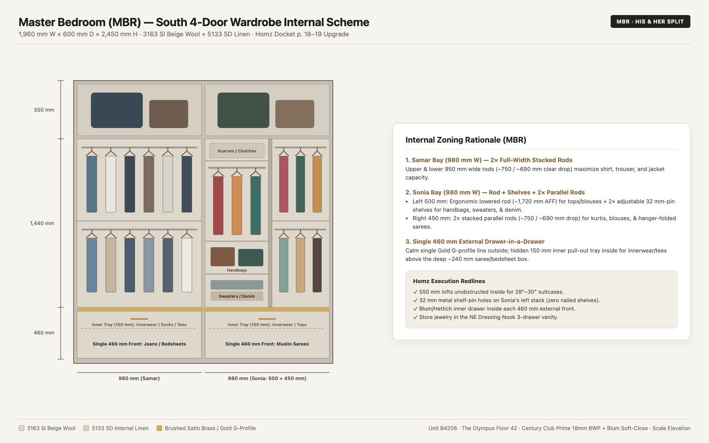
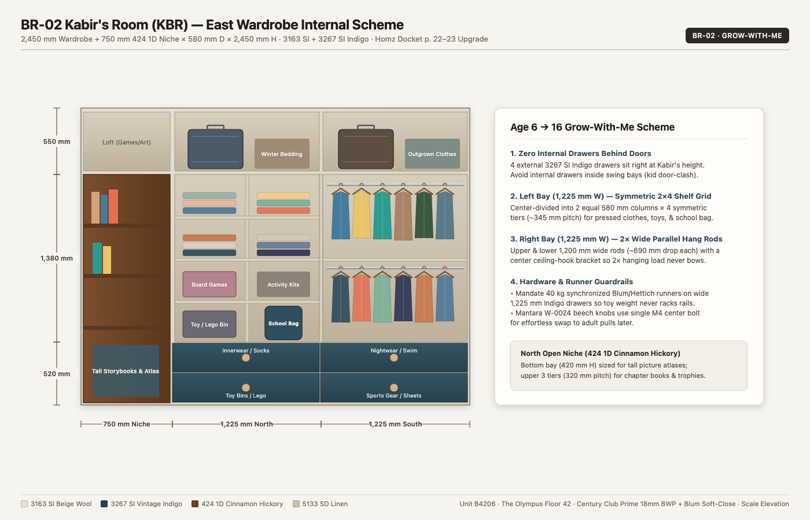
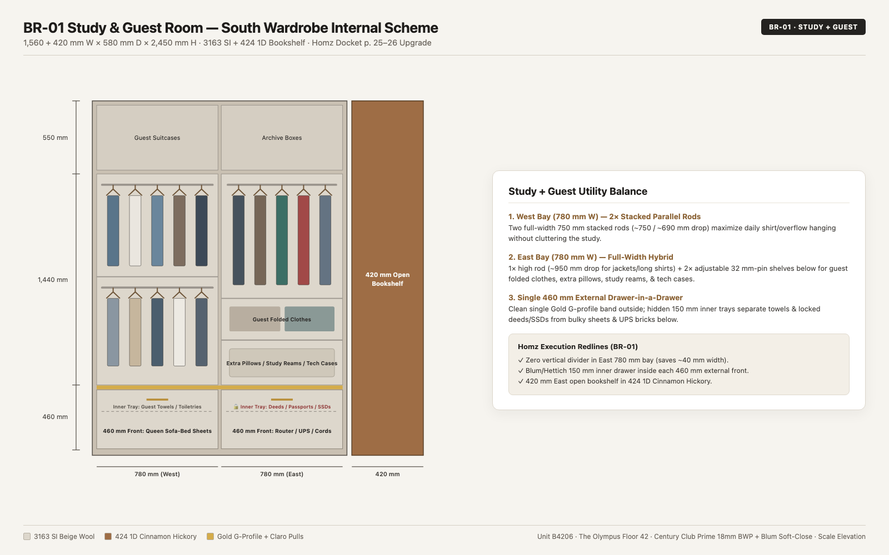
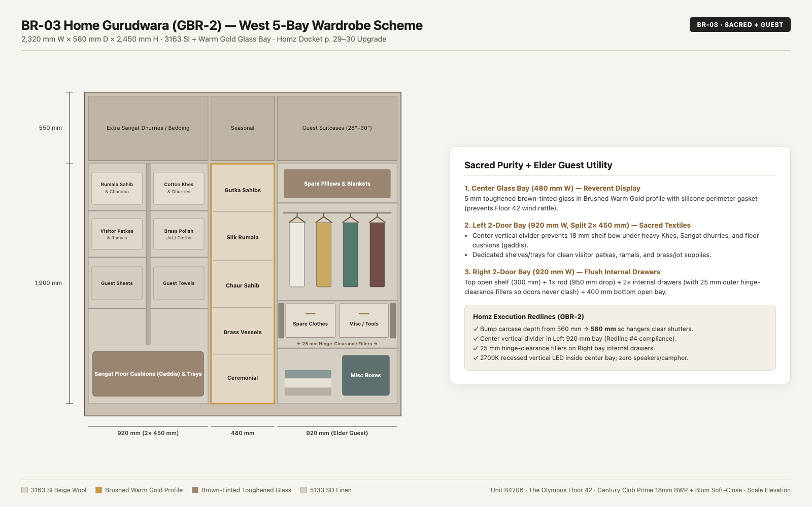
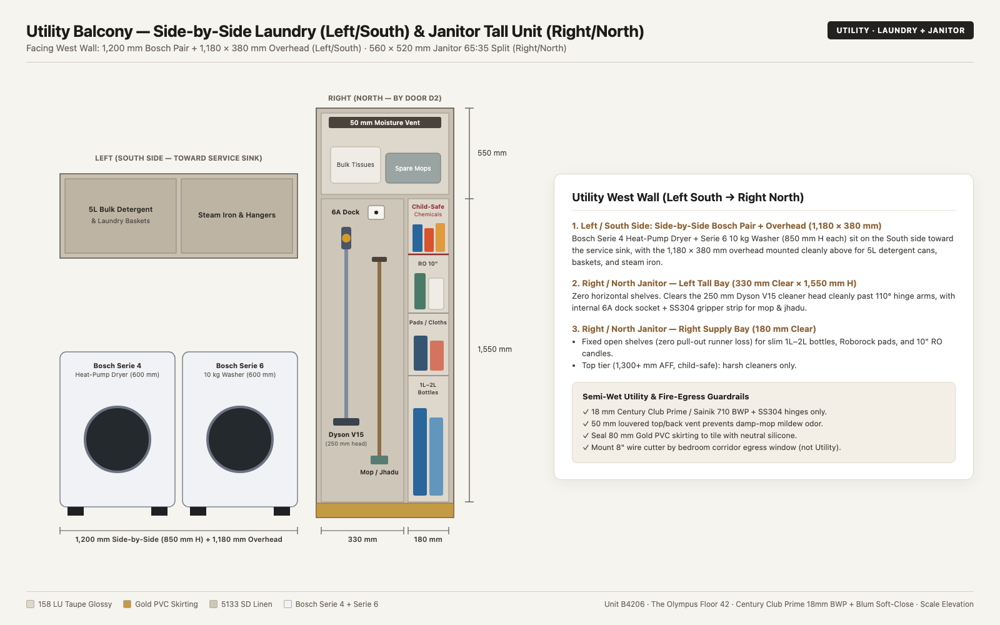

[[index|← Back to Home Overview]] · [[cabinetry-woodwork]] · [[kitchen-laundry]]

# Wardrobe & Utility Janitor Internal Storage Schemes

Internal partition, shelf-pitch, and ergonomic layout schedule for all bedroom wardrobes and the Utility janitor cabinet executed by Homz Interio (`Century Club Prime 18mm BWP` + `Blum / Hettich` soft-close hardware).

> **Four Cross-Home Redlines:** (1) Leave `550 mm` top lofts unobstructed inside (zero vertical dividers) so `28"–30"` suitcases slide in flat; (2) drill `32 mm` metal shelf-pin holes instead of nailing fixed shelves; (3) reject pull-out wire trouser/saree racks in favor of velvet hangers and deep undermount drawers; (4) split `900+ mm` bays vertically inside (`~460–480 mm` spans) so `18 mm` shelves never bow under denim.

---

## 1. Master Bedroom (`MBR`) — South 4-Door Wardrobe (`1,960 × 600 × 2,450 mm`)

Pairs maximum hanging on Samar's bay with Sonia's handbag shelves, `2×` parallel hanging column, and calm **drawer-in-a-drawer** bottom fronts (`460 mm` single external band):

* **Samar Bay (Left, `980 mm` W):** **2× Full-Width `950 mm` Stacked Hanging Rods** (`~750 mm` upper + `~690 mm` lower clear drop) for shirts, trousers, and jackets.
* **Sonia Bay (Right, `980 mm` W):** Left `500 mm` has a top scarf/clutch shelf, **1× ergonomic rod** (`~1,720 mm` AFF, `~900 mm` drop for tops/blouses), and **`2×` adjustable `32 mm`-pin shelves** below for handbags, sweaters, and denim; Right `450 mm` uses **2× stacked parallel rods** (`~750 mm` upper + `~690 mm` lower clear drop) for kurtis, blouses, and hanger-folded sarees.
* **Single `460 mm` External Drawer-in-a-Drawer (`2×` bays):** Keeps one clean `3163 SI` drawer front + Gold G-profile outside, with a hidden **`150 mm` inner pull-out tray** (`Blum/Hettich`) inside for innerwear/socks/tees above the deep `~240 mm` box for jeans, bedsheets, and muslin-wrapped sarees; store jewelry in the NE Dressing Nook `3`-drawer vanity. See [[rooms/master-bedroom]].

---

## 2. BR-02 Kabir's Room (`KBR`) — East Wardrobe (`2,450 + 750 mm` Niche × `580 × 2,450 mm`)

Pairs symmetric shelf cubbies on the left with `2×` wide parallel hanging rods on the right (`3163 SI` + `3267 SI` Indigo drawers + `424 1D` niche):

* **Zero Internal Drawers Behind Doors:** `4×` external `3267 SI` Vintage Indigo drawers (`0–520 mm` AFF) on `40 kg` synchronized runners sit at kid height, avoiding door-clash damage.
* **North Bay (Left, `1,225 mm` W):** **Symmetric `2×4` Shelf Grid** (`2` equal `580 mm` columns × `4` matching tiers at `~345 mm` pitch) for pressed clothes, toys, board games, and a lower-right school backpack cubby.
* **South Bay (Right, `1,225 mm` W):** **2× Full-Width `1,200 mm` Stacked Hanging Rods** (one below the other, `~690 mm` clear each) with a center ceiling-hook rod bracket so heavy loads never bow. See [[rooms/kabir-room]].

---

## 3. BR-01 Study & Guest Room — South Wardrobe (`1,560 + 420 mm` × `580 × 2,450 mm`)

Pairs `2×` parallel hanging in the West bay with a full-width guest/study hybrid in the East bay (`3163 SI` + `424 1D` East bookshelf):

* **West Bay (`780 mm` W):** **2× Full-Width `750 mm` Stacked Hanging Rods** (`~750 mm` upper + `~690 mm` lower clear drop) for shirts and seasonal overflow.
* **East Bay (`780 mm` W, Hybrid):** **1× high rod** (`~950 mm` drop for guest jackets/long shirts) + **`2×` adjustable `32 mm`-pin shelves** below for guest folded clothes, extra pillows, study reams, and tech cases (no vertical divider).
* **Single `460 mm` External Drawer-in-a-Drawer (`2×` bays):** Clean single `460 mm` front outside; hidden `150 mm` inner trays hold guest towels (West) and optional keyed-lock deeds/passports/SSDs (East) above deep `~240 mm` boxes for queen sofa-bed sheets and router/UPS cords. See [[rooms/study-guest-room]].

---

## 4. BR-03 Home Gurudwara (`GBR-2`) — West 5-Bay Run (`2,320 × 580 × 2,450 mm`)

Balances sacred purity with visiting parents/elder guest storage (`3163 SI`, bumped to `580 mm` carcase depth + center `480 mm` warm-gold tinted-glass bay, Docket `p. 30`):

* **Center Glass Bay (`480 mm` W):** Silicone-gasketed `5 mm` toughened glass with `2700K` LED wash for Gutka Sahibs, silk Rumala Sahib, Chaur Sahib, and ceremonial vessels.
* **Left 2-Door Bay (`920 mm` W, Split `2× 450 mm` Sacred Textiles):** Center vertical divider (`~450 mm` spans per Redline #4) + `100%` deep shelving (no rod) for Rumala Sahib, Chandoa, Khes, dhurries, and bottom Sangat *gaddis*/trays, plus dedicated shelves for clean visitor *patkas/ramals* and brass/jot supplies.
* **Right 2-Door Bay (`920 mm` W, Spare Clothes & Misc):** Top open shelf (`300 mm` H) for spare pillows/blankets, `1×` hanging rod (`950 mm` drop) for coats/guest clothes, `2×` flush internal side-by-side drawers (`250 mm` H) with **`25 mm` outer hinge-clearance fillers** (clean exterior aesthetic, zero door-hinge clash), and a `400 mm` open bottom bay for boxes or cabin bags. See [[rooms/home-gurudwara]].

---

## 5. Utility Janitor Tall Unit (`560 × 520 mm`) & Laundry Overhead (`1,180 × 380 mm`)

Facing the Utility West wall (left-to-right: **South side-by-side Bosch Dryer/Washer (`1,200 mm`) on the Left** $\rightarrow$ **North `560 × 520 mm` Janitor Tall Unit on the Right** beside Kitchen door `D2`). Strikes Homz Docket `p. 15` horizontal shelves inside the `560 mm` tall unit in favor of a **`65:35` vertical split** (`158 LU Taupe` glossy + `18 mm` BWP + SS304 hinges):

* **Left Tall Bay (`330 mm` clear × `1,550 mm` H):** Zero horizontal shelves. Gives the `250 mm` **Dyson V15** cleaner head clean clearance past `110°` hinge arms, with an internal `6A` dock socket + SS304 gripper strip for mop, floor wiper, and *jhadu*.
* **Right Supply Bay (`180 mm` clear × `1,550 mm` H):** Fixed open shelves (zero pull-out runner width loss) for `1L–5L` liquid detergent jugs at waist height, Roborock pads, and `10"` RO candles; top tier (`1,300+ mm` AFF, child-safe) holds harsh cleaners.
* **Moisture, Raised Overhead Datum & Fire-Egress Guardrails:** Include a `50 mm` top/back louvered vent for damp mops and seal the `80 mm` Gold PVC skirting to tile with neutral silicone. Mount the `1,180 × 380 × 430 mm` laundry overhead on the Left (South) at **`1,750–2,180 mm` AFF** (top flush with the `2,180 mm` Janitor loft datum), suspending a full-width **`1,100 mm × 25 × 15 mm` SS304 oval wardrobe rail** on `3× 65 mm`-drop through-bolted brackets (`1,685 mm` AFF rod top, `795 mm` net hanging drop for `35–40` hangers, zero overhead door clash) alongside the external South-wall mesh ironing board dock (see [[rooms/utility|Utility & Laundry Balcony]]). Mount the **8" SS316 wire cutter** by the bedroom corridor egress window (not inside the Utility cabinet).

